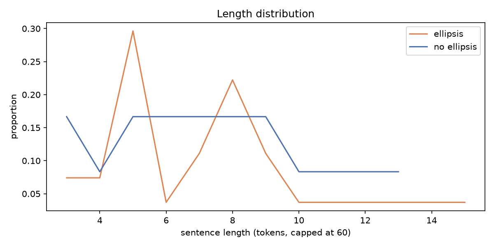
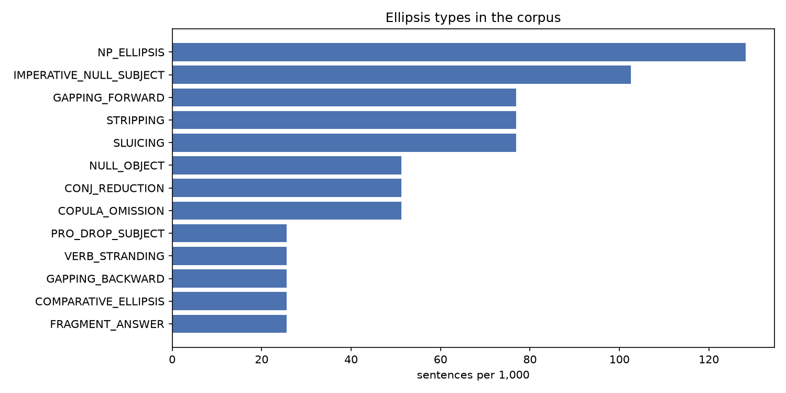
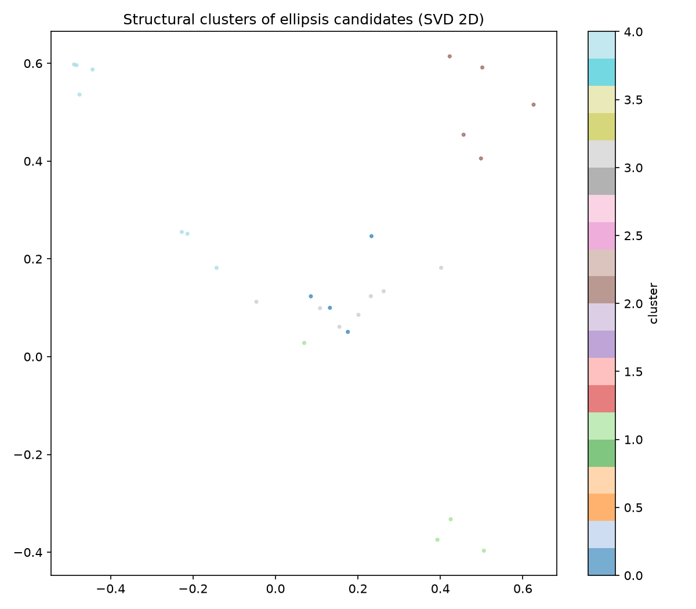
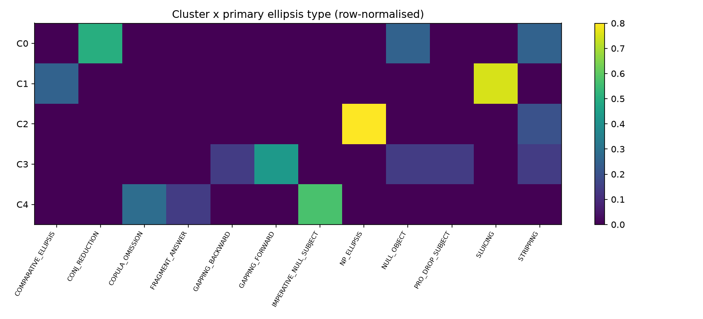
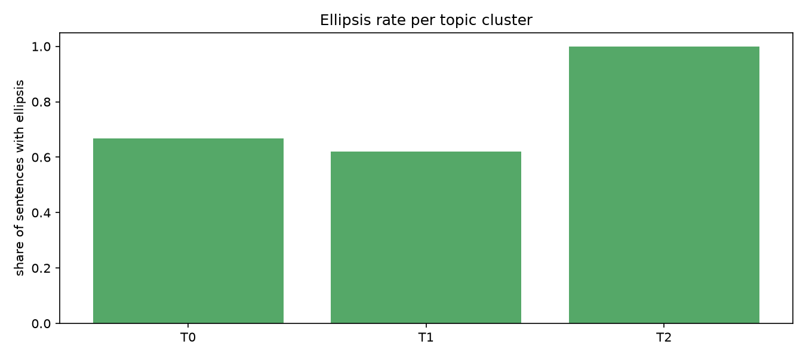

# Hindi Ellipsis Analysis Report

**Run:** source=file, path=sample_data/hi_sample.txt, max_sentences=all, min_conf=0.0, embed=none, stanza=False

## 1. Corpus overview (Level 1: ellipsis vs. no ellipsis)

- Sentences analysed: **39**  (tokens: 270)
- Sentences with at least one ellipsis candidate: **27** (69.23%)
- Mean length - ellipsis: 6.7 tokens, no ellipsis: 7.42 tokens
- Families (sentences): {'CLAUSAL': 12, 'NOMINAL': 5, 'ARGUMENT': 9, 'DISCOURSE': 3}

## 2. Types of ellipsis (Level 2)

| type | family | sentences | instances | per_1000_sentences | share_of_ellipsis_sentences | mean_confidence |
|---|---|---|---|---|---|---|
| NP_ELLIPSIS | NOMINAL | 5 | 6 | 128.205 | 0.1852 | 0.7 |
| IMPERATIVE_NULL_SUBJECT | ARGUMENT | 4 | 5 | 102.564 | 0.1481 | 0.66 |
| GAPPING_FORWARD | CLAUSAL | 3 | 3 | 76.923 | 0.1111 | 0.767 |
| STRIPPING | CLAUSAL | 3 | 3 | 76.923 | 0.1111 | 0.733 |
| SLUICING | CLAUSAL | 3 | 3 | 76.923 | 0.1111 | 0.8 |
| NULL_OBJECT | ARGUMENT | 2 | 2 | 51.282 | 0.0741 | 0.75 |
| CONJ_REDUCTION | ARGUMENT | 2 | 2 | 51.282 | 0.0741 | 0.65 |
| COPULA_OMISSION | DISCOURSE | 2 | 2 | 51.282 | 0.0741 | 0.475 |
| PRO_DROP_SUBJECT | ARGUMENT | 1 | 2 | 25.641 | 0.037 | 0.85 |
| VERB_STRANDING | CLAUSAL | 1 | 1 | 25.641 | 0.037 | 0.7 |
| GAPPING_BACKWARD | CLAUSAL | 1 | 1 | 25.641 | 0.037 | 0.8 |
| COMPARATIVE_ELLIPSIS | CLAUSAL | 1 | 1 | 25.641 | 0.037 | 0.7 |
| FRAGMENT_ANSWER | DISCOURSE | 1 | 1 | 25.641 | 0.037 | 0.5 |

### Subtypes

| type | subtype | instances |
|---|---|---|
| GAPPING_FORWARD | plain | 3 |
| NP_ELLIPSIS | quantifier_stranded | 3 |
| NP_ELLIPSIS | वाला_modifier_stranded | 3 |
| SLUICING | embedded_uncertainty | 3 |
| IMPERATIVE_NULL_SUBJECT | familiar_तुम | 3 |
| PRO_DROP_SUBJECT | 1sg_discourse | 2 |
| IMPERATIVE_NULL_SUBJECT | honorific_आप | 2 |
| CONJ_REDUCTION | shared_subject | 2 |
| NULL_OBJECT | feminine_agreement_with_silent_object | 2 |
| STRIPPING | additive_भी | 1 |
| COPULA_OMISSION | headline_telegraphic | 1 |
| COPULA_OMISSION | under_negation | 1 |
| VERB_STRANDING | with_भी | 1 |
| GAPPING_BACKWARD | verb_final_conjunct | 1 |
| FRAGMENT_ANSWER | yes_no_plus_fragment | 1 |
| STRIPPING | negative_नहीं | 1 |
| STRIPPING | alternative_question_या | 1 |
| COMPARATIVE_ELLIPSIS | correlative_उतना_verbless | 1 |

## 3. Why does each ellipsis occur? (licensing + corpus evidence)

### NP_ELLIPSIS  (NOMINAL)

Nominal (N') ellipsis: the head noun is omitted and a modifier survives (लाल वाली, दोनों ने, बड़ों को). Hindi वाला acts like English 'one' (a nominal anaphor), and adjectives/quantifiers carrying gender-number-case inflection keep the head recoverable.

Strongest associated cues in this corpus:

| cue | P(cue|type) | P(cue|rest) | odds_ratio | p_value |
|---|---|---|---|---|
| has_vala | 0.4 | 0.0 | 49.286 | 0.0069248875731735314 |
| has_focus_particle | 0.2 | 0.0588 | 4.333 | 0.8356975844820118 |
| is_question | 0.2 | 0.0588 | 4.333 | 0.8356975844820118 |
| has_wh | 0.2 | 0.1471 | 1.788 | 1.0 |

Examples:

- मुझे लाल वाली चाहिए, नीली वाली नहीं।  
  → remnant: `लाल वाली ∅[N]` · subtype: वाला_modifier_stranded · conf 0.8
- मुझे लाल वाली चाहिए, नीली वाली नहीं।  
  → remnant: `नीली वाली ∅[N]` · subtype: वाला_modifier_stranded · conf 0.8
- मेरी वाली कहाँ है?  
  → remnant: `मेरी वाली ∅[N]` · subtype: वाला_modifier_stranded · conf 0.8
- बच्चों ने खाना खाया और बड़ों ने भी।  
  → remnant: `बड़ों ∅[N] ने` · subtype: quantifier_stranded · conf 0.6
- दोनों ने मिलकर काम किया।  
  → remnant: `दोनों ∅[N] ने` · subtype: quantifier_stranded · conf 0.6

### IMPERATIVE_NULL_SUBJECT  (ARGUMENT)

Imperative morphology (-ओ familiar, -इए/-िए honorific) encodes the addressee and the politeness level, so the 2nd-person subject (तुम/आप) is recoverable from the verb and from the speech situation.

Strongest associated cues in this corpus:

_(none)_

Examples:

- कृपया अपना टिकट साथ रखिए।  
  → remnant: `∅[आप] + रखिए` · subtype: honorific_आप · conf 0.75
- सुनिए, आज बाज़ार बंद रहेगा।  
  → remnant: `∅[आप] + सुनिए` · subtype: honorific_आप · conf 0.75
- यहाँ बैठो और चुपचाप सुनो।  
  → remnant: `∅[तुम] + बैठो` · subtype: familiar_तुम · conf 0.6
- यहाँ बैठो और चुपचाप सुनो।  
  → remnant: `∅[तुम] + सुनो` · subtype: familiar_तुम · conf 0.6
- चलो, अब घर चलते हैं।  
  → remnant: `∅[तुम] + चलो` · subtype: familiar_तुम · conf 0.6

### GAPPING_FORWARD  (CLAUSAL)

Gapping deletes the finite verb (and often the auxiliary) of a non-initial conjunct, leaving two or more contrastive remnants. Hindi remnants keep their case markers (ने/को/से), which makes the parallel argument structure recoverable from morphology alone.

Strongest associated cues in this corpus:

_(none)_

Examples:

- राम ने चाय पी और सीता ने कॉफ़ी।  
  → remnant: `और सीता ने कॉफ़ी` · subtype: plain · conf 0.85
- भारत ने ऑस्ट्रेलिया को हराया और न्यूजीलैंड ने इंग्लैंड को।  
  → remnant: `और न्यूजीलैंड ने इंग्लैंड को` · subtype: plain · conf 0.85
- यह मकान पुराना है और वह नया।  
  → remnant: `और वह नया` · subtype: plain · conf 0.6

### STRIPPING  (CLAUSAL)

Stripping / bare-argument ellipsis: the whole clause except one remnant is elided. In Hindi the remnant is typically hosted by a focus particle (भी 'also', ही 'only') or negation (नहीं), which marks the remnant as contrastive/additive focus and licenses the deletion of the given (background) material.

Strongest associated cues in this corpus:

_(none)_

Examples:

- बच्चों ने खाना खाया और बड़ों ने भी।  
  → remnant: `और बड़ों ने भी` · subtype: additive_भी · conf 0.8
- टीम ने पहला मैच जीता लेकिन दूसरा नहीं।  
  → remnant: `लेकिन दूसरा नहीं` · subtype: negative_नहीं · conf 0.8
- आप चाय लेंगे या कॉफ़ी?  
  → remnant: `या कॉफ़ी` · subtype: alternative_question_या · conf 0.6

### SLUICING  (CLAUSAL)

Sluicing: a clause is elided leaving only a wh-phrase. Hindi is wh-in-situ, so sluicing is analysed either as wh-movement + TP deletion or as a reduced (pseudo-)cleft/copular clause. It is typically licensed by an uncertainty predicate (पता नहीं, मालूम नहीं) and an indefinite correlate (किसी, कोई, कुछ) in the antecedent.

Strongest associated cues in this corpus:

_(none)_

Examples:

- किसी ने दरवाज़ा खटखटाया था, पता नहीं कौन।  
  → remnant: `पता नहीं कौन` · subtype: embedded_uncertainty · conf 0.8
- पुलिस ने बताया कि कुछ लोग गिरफ्तार हुए हैं लेकिन यह नहीं बताया कि कितने।  
  → remnant: `बताया कि कितने` · subtype: embedded_uncertainty · conf 0.8
- कोई आया था पर मालूम नहीं कब।  
  → remnant: `मालूम नहीं कब` · subtype: embedded_uncertainty · conf 0.8

### NULL_OBJECT  (ARGUMENT)

Hindi allows argument (object) ellipsis when the object is given in discourse. In perfective transitive clauses the subject takes ergative ने and the verb agrees with the (unmarked) object; when that object is elided the verb either shows default -ा agreement or keeps agreeing with the silent object (e.g. feminine -ी), which is evidence that the null object is syntactically present (argument ellipsis, not just an intransitive use).

Strongest associated cues in this corpus:

_(none)_

Examples:

- राम ने किताब पढ़ी और सीता ने भी पढ़ी।  
  → remnant: `सीता ने ∅[OBJ] पढ़ी` · subtype: feminine_agreement_with_silent_object · conf 0.75
- उसने खा ली।  
  → remnant: `उसने ∅[OBJ] खा ली` · subtype: feminine_agreement_with_silent_object · conf 0.75

### CONJ_REDUCTION  (ARGUMENT)

In clausal coordination, an argument shared with the first conjunct (usually the subject/topic) is omitted in the second conjunct. This is licensed by topic continuity and by the parallelism of coordinated clauses (conjunction reduction / across-the-board subject sharing).

Strongest associated cues in this corpus:

_(none)_

Examples:

- वह घर आया और सो गया।  
  → remnant: `और ∅[SUBJ] सो गया` · subtype: shared_subject · conf 0.65
- उसने किताब पढ़ी और अपने दोस्त को दे दी।  
  → remnant: `और ∅[SUBJ] अपने दोस्त को दे दी` · subtype: shared_subject · conf 0.65

### COPULA_OMISSION  (DISCOURSE)

The present copula है/हैं can be dropped under negation (वह घर पर नहीं) and in telegraphic registers such as news headlines (मोदी आज वाराणसी में). Tense is recovered from context; this is register-driven ellipsis.

Strongest associated cues in this corpus:

_(none)_

Examples:

- मंत्री जी कार्यालय में नहीं।  
  → remnant: `कार्यालय में नहीं ∅[है]` · subtype: under_negation · conf 0.6
- प्रधानमंत्री आज वाराणसी में।  
  → remnant: `आज वाराणसी में ∅[V]` · subtype: headline_telegraphic · conf 0.35

### PRO_DROP_SUBJECT  (ARGUMENT)

Hindi is a (consistent/partial) pro-drop language: finite verbs and auxiliaries carry person-number-gender agreement (हूँ = 1sg, -ोगे = 2fam, -ूँगा = 1sg.fut), so an overt subject pronoun is redundant when the referent is a discourse topic. Overt pronouns appear mainly for contrast, focus or topic shift.

Strongest associated cues in this corpus:

_(none)_

Examples:

- कल सुबह दिल्ली जाऊँगा और शाम तक लौट आऊँगा।  
  → remnant: `∅[मैं] + जाऊँगा` · subtype: 1sg_discourse · conf 0.85
- कल सुबह दिल्ली जाऊँगा और शाम तक लौट आऊँगा।  
  → remnant: `∅[मैं] + आऊँगा` · subtype: 1sg_discourse · conf 0.85

### VERB_STRANDING  (CLAUSAL)

Repeated verb with missing internal argument after भी: either verb-stranding VP ellipsis (the verb moves out of the VP before the VP is elided) or argument ellipsis of the object. Hindi-Urdu is a key language in this debate because verb movement and complex predicates interact with ellipsis.

Strongest associated cues in this corpus:

_(none)_

Examples:

- राम ने किताब पढ़ी और सीता ने भी पढ़ी।  
  → remnant: `और सीता ने भी पढ़ी` · subtype: with_भी · conf 0.7

### GAPPING_BACKWARD  (CLAUSAL)

As an SOV, verb-final language Hindi also allows BACKWARD gapping: the verb is pronounced only in the final conjunct and the earlier conjunct is verbless (राम ने चाय, और सीता ने कॉफ़ी पी). This direction follows from head-finality (Ross 1970's directionality generalisation).

Strongest associated cues in this corpus:

_(none)_

Examples:

- अमित ने सेब और सुमित ने आम खरीदे।  
  → remnant: `अमित ने सेब और` · subtype: verb_final_conjunct · conf 0.8

### COMPARATIVE_ELLIPSIS  (CLAUSAL)

Comparative clauses (जितना ... उतना, X से ज़्यादा) elide the predicate that is identical to the matrix clause; the correlative structure of Hindi comparatives provides the parallelism needed for recovery.

Strongest associated cues in this corpus:

_(none)_

Examples:

- वह जितना पढ़ता है उतना उसका भाई नहीं।  
  → remnant: `उतना उसका भाई नहीं` · subtype: correlative_उतना_verbless · conf 0.7

### FRAGMENT_ANSWER  (DISCOURSE)

Fragment answers / short replies (हाँ, कल / नहीं, राम ने) elide everything already present in the question under discourse (QUD); only the new-information focus is pronounced.

Strongest associated cues in this corpus:

_(none)_

Examples:

- हाँ, कल सुबह।  
  → remnant: `हाँ कल सुबह` · subtype: yes_no_plus_fragment · conf 0.5

## 4. Structural clusters of ellipsis sentences (Level 3a)

Silhouette scores by k: {2: 0.104, 3: 0.1186, 4: 0.1712, 5: 0.2201}

| cluster | size | share | dominant_type | type_purity | type_mix | mean_len | top_shape_ngrams |
|---|---|---|---|---|---|---|---|
| 0 | 4 | 0.1481 | CONJ_REDUCTION | 0.5 | CONJ_REDUCTION:2; NULL_OBJECT:1; STRIPPING:1 | 5.8 | V AUX PUNCT / V AUX / V / PRON_ERG / AUX / AUX PUNCT |
| 1 | 4 | 0.1481 | SLUICING | 0.75 | SLUICING:3; COMPARATIVE_ELLIPSIS:1 | 9.5 | NEG / AUX / WH PUNCT / INDEF / WH / W |
| 2 | 5 | 0.1852 | NP_ELLIPSIS | 1.0 | NP_ELLIPSIS:5; STRIPPING:1 | 5.8 | VALA / AUX PUNCT / QUANT / AUX / W / W AUX PUNCT |
| 3 | 7 | 0.2593 | GAPPING_FORWARD | 0.429 | GAPPING_FORWARD:3; PRO_DROP_SUBJECT:1; NULL_OBJECT:1; VERB_STRANDING:1 | 8.4 | W CASE_ERG / W / CASE_ERG / W CASE_ERG W / CASE_ERG W / CONJ |
| 4 | 7 | 0.2593 | IMPERATIVE_NULL_SUBJECT | 0.571 | IMPERATIVE_NULL_SUBJECT:4; COPULA_OMISSION:2; FRAGMENT_ANSWER:1 | 4.6 | W W / W / W W W / PUNCT / W PUNCT / PUNCT W |

**Cluster 0** (CONJ_REDUCTION, purity 0.5): pattern `V AUX PUNCT | V AUX | V | PRON_ERG | AUX | AUX PUNCT`
  - उसने खा ली।
  - वह घर आया और सो गया।
  - उसने किताब पढ़ी और अपने दोस्त को दे दी।
**Cluster 1** (SLUICING, purity 0.75): pattern `NEG | AUX | WH PUNCT | INDEF | WH | W`
  - किसी ने दरवाज़ा खटखटाया था, पता नहीं कौन।
  - पुलिस ने बताया कि कुछ लोग गिरफ्तार हुए हैं लेकिन यह नहीं बताया कि कितने।
  - कोई आया था पर मालूम नहीं कब।
**Cluster 2** (NP_ELLIPSIS, purity 1.0): pattern `VALA | AUX PUNCT | QUANT | AUX | W | W AUX PUNCT`
  - बच्चों ने खाना खाया और बड़ों ने भी।
  - मुझे लाल वाली चाहिए, नीली वाली नहीं।
  - मेरी वाली कहाँ है?
**Cluster 3** (GAPPING_FORWARD, purity 0.429): pattern `W CASE_ERG | W | CASE_ERG | W CASE_ERG W | CASE_ERG W | CONJ`
  - राम ने चाय पी और सीता ने कॉफ़ी।
  - कल सुबह दिल्ली जाऊँगा और शाम तक लौट आऊँगा।
  - भारत ने ऑस्ट्रेलिया को हराया और न्यूजीलैंड ने इंग्लैंड को।
**Cluster 4** (IMPERATIVE_NULL_SUBJECT, purity 0.571): pattern `W W | W | W W W | PUNCT | W PUNCT | PUNCT W`
  - कृपया अपना टिकट साथ रखिए।
  - सुनिए, आज बाज़ार बंद रहेगा।
  - यहाँ बैठो और चुपचाप सुनो।

### Sub-patterns within each type

_(none)_

## 5. Topic 'parts' of the dataset (Level 3b)

| topic | size | ellipsis_rate | top_terms | rate_PRO_DROP_SUBJECT | rate_IMPERATIVE_NULL_SUBJECT | rate_NULL_OBJECT | rate_CONJ_REDUCTION | rate_GAPPING_FORWARD | rate_GAPPING_BACKWARD |
|---|---|---|---|---|---|---|---|---|---|
| 2 | 7 | 1.0 | नहीं में वह है भी तुम को कल उसने आज | 0.0 | 0.0 | 0.0 | 0.0 | 0.0 | 0.0 |
| 0 | 3 | 0.6667 | भी है वह में नहीं तुम को कल उसने आज | 0.0 | 0.0 | 0.3333 | 0.0 | 0.0 | 0.0 |
| 1 | 29 | 0.6207 | को उसने तुम है कल आज वह में नहीं भी | 0.0345 | 0.1379 | 0.0345 | 0.069 | 0.1034 | 0.0345 |

## Research background and hypotheses

**Why Hindi is ellipsis-rich.** Four grammatical properties drive almost every
type detected here:

1. *Rich agreement + topic-oriented discourse* -> null subjects (pro-drop) and
   null objects (argument ellipsis). Hindi subjects are recoverable from verb
   agreement (हूँ, -ूँगा, -ोगे) and from discourse topicality; objects are
   recoverable when given in context.
2. *Split ergativity.* In perfective transitive clauses the subject is marked
   ने and the verb agrees with the unmarked object (Mahajan 1990). This makes
   null objects visible: the verb can keep feminine/plural agreement with an
   object that is not pronounced (राम ने ∅ पढ़ी), a classic argument that the
   null object is syntactically present.
3. *Head-final (SOV) order.* The verb is clause-final, so in coordination the
   verb can be shared forward (gapping) or *backward* (verb only in the last
   conjunct) - a directionality predicted for verb-final languages since
   Ross (1970).
4. *Postpositional case and focus particles.* Remnants keep their case markers
   (ने, को, से) and are hosted by focus particles (भी, ही) or negation (नहीं),
   which mark them as contrastive/additive foci; given material is deleted
   (stripping, verb-stranding constructions).
5. *Wh-in-situ.* Sluicing exists despite no overt wh-movement; whether it
   involves movement + deletion or a reduced copular/cleft source is debated
   for Indo-Aryan (Bhattacharya & Simpson 2012; Merchant 2001 for the
   general theory).

**Testable hypotheses this pipeline lets you check on the full corpus**

| # | Hypothesis | Where to look |
|---|---|---|
| H1 | Stripping is strongly associated with भी/नहीं (focus licensing). | `cue_association.csv`: STRIPPING x has_focus_particle / has_negation |
| H2 | Null objects concentrate in ergative clauses, and a measurable share keep non-default (fem./pl.) agreement -> syntactically real null objects. | NULL_OBJECT subtypes in `subtype_counts.csv` |
| H3 | Forward gapping is more frequent than backward gapping, but backward gapping is attested (SOV). | GAPPING_FORWARD vs GAPPING_BACKWARD rates |
| H4 | Copula omission is register-bound (headlines, short verbless lines). | COPULA_OMISSION x is_verbless / length, topic table |
| H5 | Sluicing requires an uncertainty predicate or indefinite correlate. | SLUICING subtypes, has_indefinite odds ratio |
| H6 | 1st/2nd-person subjects are dropped more often in dialogue-heavy / opinion text than in reportage. | PRO_DROP rate per topic cluster |
| H7 | Ellipsis sentences are on average longer (coordination) or much shorter (fragments) than non-ellipsis sentences - a bimodal profile. | `length_distribution.png` |

**Key references**

- Bhatt, R., Narasimhan, B., Palmer, M., Rambow, O., Sharma, D. M., & Xia, F. (2009). A multi-representational and multi-layered treebank for Hindi/Urdu. *Proc. Linguistic Annotation Workshop III*. (HDTB - annotates empty/NULL nodes; good gold source for evaluation.)
- Bhattacharya, T., & Simpson, A. (2012). Sluicing in Indo-Aryan: an investigation of Bangla and Hindi. In J. Merchant & A. Simpson (eds.), *Sluicing: Cross-Linguistic Perspectives*. OUP.
- Butt, M. (1995). *The Structure of Complex Predicates in Urdu*. CSLI.
- Doddapaneni, S. et al. (2023). Towards leaving no Indic language behind: building monolingual corpora, benchmark and models for Indic languages (IndicCorp v2). *ACL*.
- Kachru, Y. (2006). *Hindi*. John Benjamins (London Oriental and African Language Library).
- Kakwani, D. et al. (2020). IndicNLPSuite: monolingual corpora, evaluation benchmarks and pre-trained multilingual language models for Indian languages (IndicCorp v1). *Findings of EMNLP*.
- Mahajan, A. (1990). *The A/A-bar Distinction and Movement Theory*. PhD dissertation, MIT.
- Manetta, E. (2019). Verb-phrase ellipsis and complex predicates in Hindi-Urdu. *Natural Language & Linguistic Theory* 37.
- Merchant, J. (2001). *The Syntax of Silence: Sluicing, Islands, and the Theory of Ellipsis*. OUP.
- Merchant, J. (2004). Fragments and ellipsis. *Linguistics and Philosophy* 27.
- Neeleman, A., & Szendrői, K. (2007). Radical pro drop and the morphology of pronouns. *Linguistic Inquiry* 38.
- Qi, P., Zhang, Y., Zhang, Y., Bolton, J., & Manning, C. D. (2020). Stanza: a Python NLP toolkit for many human languages. *ACL demos*.
- Ross, J. R. (1970). Gapping and the order of constituents. In Bierwisch & Heidolph (eds.), *Progress in Linguistics*.
- Simpson, A., Choudhury, A., & Menon, M. (2013). Argument ellipsis and the licensing of covert nominals in Bangla, Hindi and Malayalam. *Lingua* 134.

## Caveats
- Detectors are heuristic (precision-oriented). Validate with `annotation_sample.csv` + `evaluate.py` before drawing linguistic conclusions.
- 3rd-person pro-drop cannot be detected reliably without a parser (agreement is ambiguous); use `--use_stanza`.
- Sentence-level analysis ignores cross-sentence antecedents; `prev_sentence` is stored in the outputs for manual inspection.
