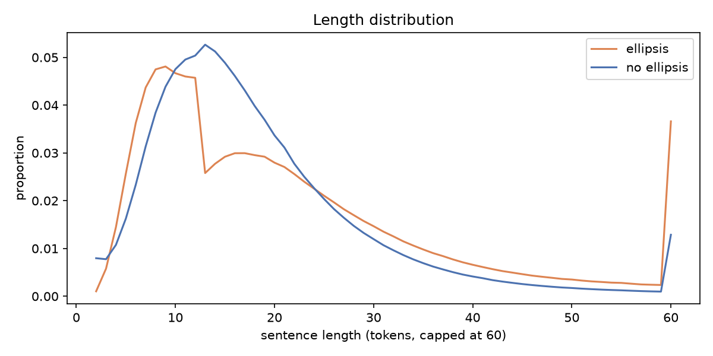
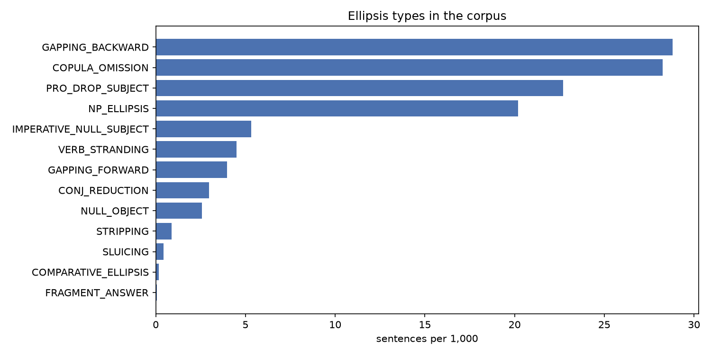
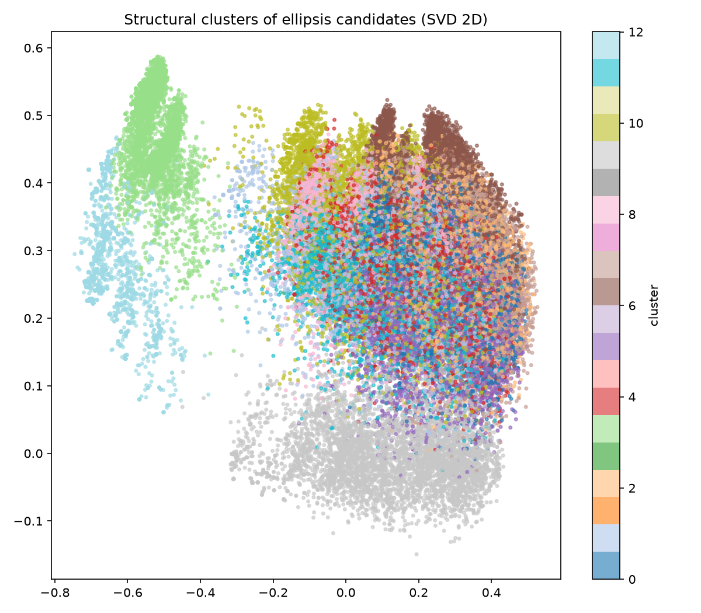
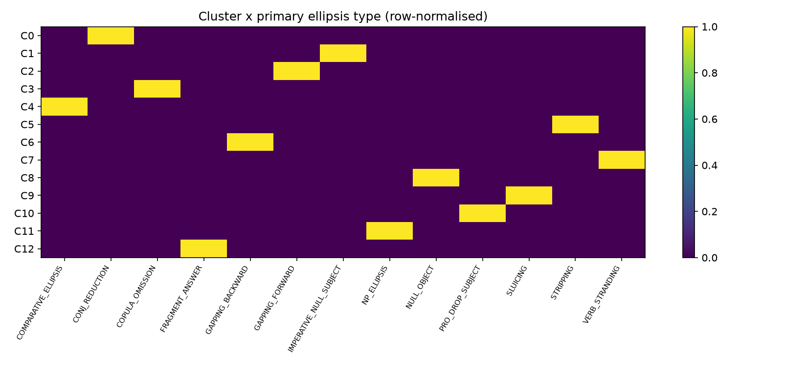
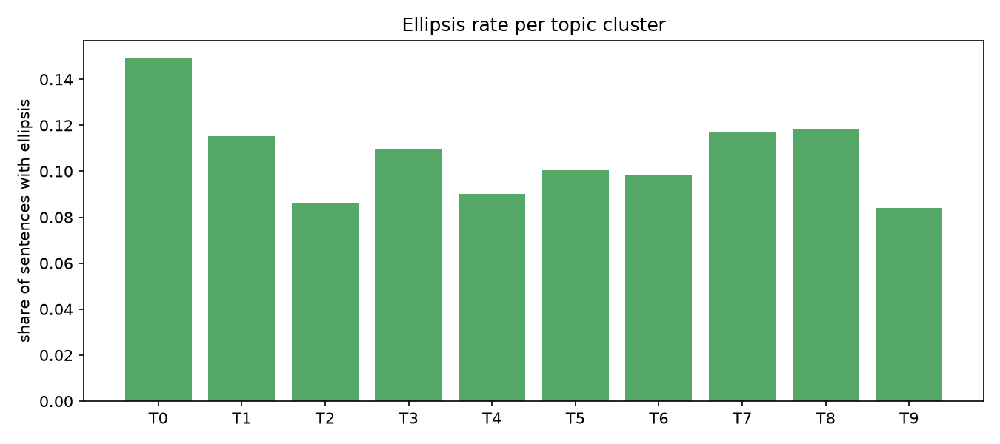

# Hindi Ellipsis Analysis Report

**Run:** source=file, path=indiccorpv2_hindi/data/hi-*.txt, max_sentences=all, min_conf=0.0, embed=none, stanza=False

## 1. Corpus overview (Level 1: ellipsis vs. no ellipsis)

- Sentences analysed: **293,577,287**  (tokens: 5,540,880,835)
- Sentences with at least one ellipsis candidate: **34,009,385** (11.58%)
- Mean length - ellipsis: 20.99 tokens, no ellipsis: 18.44 tokens
- Families (sentences): {'DISCOURSE': 8311584, 'CLAUSAL': 11281410, 'ARGUMENT': 9734827, 'NOMINAL': 5930974}

## 2. Types of ellipsis (Level 2)

| type | family | sentences | instances | per_1000_sentences | share_of_ellipsis_sentences | mean_confidence |
|---|---|---|---|---|---|---|
| GAPPING_BACKWARD | CLAUSAL | 8458109 | 8508379 | 28.811 | 0.2487 | 0.507 |
| COPULA_OMISSION | DISCOURSE | 8291008 | 8291008 | 28.241 | 0.2438 | 0.359 |
| PRO_DROP_SUBJECT | ARGUMENT | 6663160 | 6954113 | 22.696 | 0.1959 | 0.725 |
| NP_ELLIPSIS | NOMINAL | 5930974 | 6155080 | 20.202 | 0.1744 | 0.587 |
| IMPERATIVE_NULL_SUBJECT | ARGUMENT | 1563762 | 1732203 | 5.327 | 0.046 | 0.664 |
| VERB_STRANDING | CLAUSAL | 1321895 | 1324366 | 4.503 | 0.0389 | 0.523 |
| GAPPING_FORWARD | CLAUSAL | 1162837 | 1165120 | 3.961 | 0.0342 | 0.609 |
| CONJ_REDUCTION | ARGUMENT | 874284 | 878846 | 2.978 | 0.0257 | 0.65 |
| NULL_OBJECT | ARGUMENT | 758566 | 765684 | 2.584 | 0.0223 | 0.575 |
| STRIPPING | CLAUSAL | 256752 | 257417 | 0.875 | 0.0075 | 0.623 |
| SLUICING | CLAUSAL | 128021 | 134627 | 0.436 | 0.0038 | 0.68 |
| COMPARATIVE_ELLIPSIS | CLAUSAL | 50806 | 51160 | 0.173 | 0.0015 | 0.588 |
| FRAGMENT_ANSWER | DISCOURSE | 22445 | 22445 | 0.076 | 0.0007 | 0.5 |

### Subtypes

| type | subtype | instances |
|---|---|---|
| GAPPING_BACKWARD | verb_final_conjunct | 8508379 |
| COPULA_OMISSION | headline_telegraphic | 8008913 |
| PRO_DROP_SUBJECT | 2fam_discourse | 5391156 |
| NP_ELLIPSIS | वाला_headless_participial | 3037586 |
| NP_ELLIPSIS | quantifier_stranded | 2259814 |
| VERB_STRANDING | plain | 1172033 |
| PRO_DROP_SUBJECT | 1sg_discourse | 1138738 |
| GAPPING_FORWARD | plain | 1130082 |
| IMPERATIVE_NULL_SUBJECT | familiar_तुम | 990407 |
| CONJ_REDUCTION | shared_subject | 878846 |
| IMPERATIVE_NULL_SUBJECT | honorific_आप | 741796 |
| NP_ELLIPSIS | वाला_other | 734951 |
| NULL_OBJECT | default_agreement | 667575 |
| PRO_DROP_SUBJECT | 1sg_shared_antecedent | 424219 |
| COPULA_OMISSION | under_negation | 282095 |
| VERB_STRANDING | with_भी | 152333 |
| STRIPPING | contrastive_bare | 120653 |
| NP_ELLIPSIS | adjective_stranded | 119350 |
| NULL_OBJECT | feminine_agreement_with_silent_object | 86110 |
| SLUICING | embedded_uncertainty | 67306 |
| STRIPPING | negative_नहीं | 58782 |
| STRIPPING | additive_भी | 55664 |
| SLUICING | wh_fragment_question | 40064 |
| COMPARATIVE_ELLIPSIS | correlative_जितना | 38222 |
| GAPPING_FORWARD | with_particle | 35038 |
| SLUICING | matrix_with_correlate | 26553 |
| FRAGMENT_ANSWER | yes_no_plus_fragment | 22445 |
| STRIPPING | alternative_question_या | 17001 |
| COMPARATIVE_ELLIPSIS | correlative_उतना_verbless | 12938 |
| NULL_OBJECT | plural_agreement_with_silent_object | 11999 |
| STRIPPING | exclusive_ही | 4779 |
| NP_ELLIPSIS | वाला_modifier_stranded | 3379 |
| SLUICING | why_not | 704 |
| STRIPPING | contrastive_तो | 538 |

## 3. Why does each ellipsis occur? (licensing + corpus evidence)

### GAPPING_BACKWARD  (CLAUSAL)

As an SOV, verb-final language Hindi also allows BACKWARD gapping: the verb is pronounced only in the final conjunct and the earlier conjunct is verbless (राम ने चाय, और सीता ने कॉफ़ी पी). This direction follows from head-finality (Ross 1970's directionality generalisation).

Strongest associated cues in this corpus:

| cue | P(cue|type) | P(cue|rest) | odds_ratio | p_value |
|---|---|---|---|---|
| has_coordination | 0.9996 | 0.2908 | 6442.294 | 0.0 |
| long_sentence_gt20 | 0.6626 | 0.3209 | 4.155 | 0.0 |
| has_ergative_ne | 0.4035 | 0.2859 | 1.69 | 0.0 |
| has_vala | 0.0854 | 0.0534 | 1.655 | 0.0 |

Examples:

- टीम इंडिया के लिए दिलप्रीत सिंह ने 7वें, गुरजंत सिंह ने 16वें और हार्दिक सिंह ने 57वें मिनट में गोल दागा।  
  → remnant: `गुरजंत सिंह ने 16 वें और` · subtype: verb_final_conjunct · conf 0.8
- कक्षा 6 से 8वीं की रागनी प्रतियोगिता में यमुनानगर के छछरोली स्कूल ने प्रथम, हिसार नारनौद के बच्चों ने दूसरा,कुरुक्षेत्र के माडल वरिष्ठ माध्यमिक विद्यालय ने तीसरे तथा जींद के माध्यमिक स्कूल हरनामपुरा ने सांत्वना पुरस्कार पर कब्जा किया।  
  → remnant: `कुरुक्षेत्र के माडल वरिष्ठ माध्यमिक विद्यालय ने तीसरे तथा` · subtype: verb_final_conjunct · conf 0.8
- साथ ही लंदन में रहने वाले भारतीय मूल के अनुज चतुर्वेदी ने 60 हजार और दिल्ली के राजेश भाटी ने 50 हजार रुपये की आर्थिक मदद की थी।  
  → remnant: `साथ ही लंदन में रहने वाले भारतीय मूल के अनुज चतुर्वेदी ने 60 हजार और` · subtype: verb_final_conjunct · conf 0.8
- विद्रोहियों का नेतृत्व इन जनजातियों/जातियों के मुखिया या उनके राजाओं ने किया था. जैसे रानी लक्ष्मीबाई ने कबूतरा (कंजर) और गनेश महतों (लोधी राजपूत) ने अंग्रेज़ों की सरपरस्त चरखारी के किले पर चढ़ाई के लिए कुचबंदिया समुदाय का उपयोग किया था.  
  → remnant: `जैसे रानी लक्ष्मीबाई ने कबूतरा ( कंजर ) और` · subtype: verb_final_conjunct · conf 0.8
- जसप्रीत बुमराह ने तीन, ईशांत शर्मा ने दो और रविचंद्रन अश्विन ने एक विकेट लिया।  
  → remnant: `ईशांत शर्मा ने दो और` · subtype: verb_final_conjunct · conf 0.8

### COPULA_OMISSION  (DISCOURSE)

The present copula है/हैं can be dropped under negation (वह घर पर नहीं) and in telegraphic registers such as news headlines (मोदी आज वाराणसी में). Tense is recovered from context; this is register-driven ellipsis.

Strongest associated cues in this corpus:

| cue | P(cue|type) | P(cue|rest) | odds_ratio | p_value |
|---|---|---|---|---|
| is_verbless | 1.0 | 0.0542 | 289205850.605 | 0.0 |
| has_imperative_form | 0.0366 | 0.0498 | 0.726 | 0.0 |
| has_negation | 0.073 | 0.1167 | 0.596 | 0.0 |
| has_ergative_ne | 0.1464 | 0.2934 | 0.413 | 0.0 |

Examples:

- ईएमआई का विकल्प नहीं  
  → remnant: `का विकल्प नहीं ∅[है]` · subtype: under_negation · conf 0.6
- स्पष्ट रूप से नहीं।  
  → remnant: `रूप से नहीं ∅[है]` · subtype: under_negation · conf 0.6
- संपादक पद की गरिमा अब नहीं।  
  → remnant: `गरिमा अब नहीं ∅[है]` · subtype: under_negation · conf 0.6
- लेकिन अभी तक किसी के हताहत होने की कोई खबर नहीं।  
  → remnant: `कोई खबर नहीं ∅[है]` · subtype: under_negation · conf 0.6
- आपकी कोई नहीं।  
  → remnant: `आपकी कोई नहीं ∅[है]` · subtype: under_negation · conf 0.6

### PRO_DROP_SUBJECT  (ARGUMENT)

Hindi is a (consistent/partial) pro-drop language: finite verbs and auxiliaries carry person-number-gender agreement (हूँ = 1sg, -ोगे = 2fam, -ूँगा = 1sg.fut), so an overt subject pronoun is redundant when the referent is a discourse topic. Overt pronouns appear mainly for contrast, focus or topic shift.

Strongest associated cues in this corpus:

| cue | P(cue|type) | P(cue|rest) | odds_ratio | p_value |
|---|---|---|---|---|
| has_1sg_agreement | 0.2237 | 0.0058 | 49.14 | 0.0 |
| has_wh | 0.0509 | 0.0269 | 1.94 | 0.0 |
| long_sentence_gt20 | 0.4438 | 0.3282 | 1.634 | 0.0 |
| is_question | 0.0159 | 0.0103 | 1.549 | 0.0 |

Examples:

- इस दौरान उनके ‘रांसु नृत्य गीत मिजाजी हौसियां...,जिंदगी को सुख पाई मैन तेरी आख्यूं मां.., जागर भगवती राज राजेश्वरी..,पंडौं जागर दुर्योधन भीम युद्ध.., शिवजी कैलाश ओ शिवजी कैलाश, सरूली मेरो जिया लागी गो, की प्रस्तुति पर लोगों ने जमकर ठुमके लगाए।  
  → remnant: `∅[मैं] + आख्यूं` · subtype: 1sg_discourse · conf 0.85
- ज्यादातर समय में मेरा मोबाइल बंद रहता है ताकि गेम के अलावा अन्य किसी चीज़ पर ध्यान ना दूँ.एशियन गेम्स के बाद 2024 में पेरिस में ओलंपिक खेलों में उसे किसी भी सूरत में क्वालीफाई करना है जिसके लिए अभी से मेहनत कर रही हूँ.  
  → remnant: `∅[मैं] + हूँ` · subtype: 1sg_discourse · conf 0.85
- गेहूं के 12 करोड़ का भुगतान, धान के नौ करोड़ बाकी  
  → remnant: `∅[मैं] + गेहूं` · subtype: 1sg_discourse · conf 0.85
- किसान ओमप्रकाश पाण्डेय, दीना राय, सोनू राय ने बताया की करीब चार- पांच एकड गेहूं की खेती तरह से बर्बाद हो गई है ।  
  → remnant: `∅[मैं] + गेहूं` · subtype: 1sg_discourse · conf 0.85
- मुख्यमंत्री दिनेश शर्मा ने कहा कि पहले भी आ चुका हूं।  
  → remnant: `∅[मैं] + हूं` · subtype: 1sg_discourse · conf 0.85

### NP_ELLIPSIS  (NOMINAL)

Nominal (N') ellipsis: the head noun is omitted and a modifier survives (लाल वाली, दोनों ने, बड़ों को). Hindi वाला acts like English 'one' (a nominal anaphor), and adjectives/quantifiers carrying gender-number-case inflection keep the head recoverable.

Strongest associated cues in this corpus:

| cue | P(cue|type) | P(cue|rest) | odds_ratio | p_value |
|---|---|---|---|---|
| has_vala | 0.6285 | 0.0425 | 38.153 | 0.0 |
| long_sentence_gt20 | 0.486 | 0.3276 | 1.941 | 0.0 |
| has_coordination | 0.423 | 0.3089 | 1.64 | 0.0 |
| has_ergative_ne | 0.3723 | 0.2876 | 1.469 | 0.0 |

Examples:

- अब भी दिल्ली दूर नही, ढूंढना चाहो तो वो मिल सकती है (अपने रवि रतलामी “जिन खोजा तिन पांइया” सर्विस चलाते है।(मेरी वाली को ढूंढ रहे है, तुम्हारी वाली को भी ढूंढ देंगे) दुख हुआ पढ कर!  
  → remnant: `मेरी वाली ∅[N]` · subtype: वाला_modifier_stranded · conf 0.8
- तेवर वहीं पुराने वाले थे, भले स्वास्थ्य कारणों से आवाज थोड़ी कमजोर थी।  
  → remnant: `पुराने वाले ∅[N]` · subtype: वाला_modifier_stranded · conf 0.8
- लाला जी को पैकेट वापस करके बोला कि ये वाला नहीं स्वदेशी वाला क्लोजअप दो।  
  → remnant: `ये वाला ∅[N]` · subtype: वाला_modifier_stranded · conf 0.8
- इन युवाओं को रोजगार देने के लिए सरकार निजी व सरकारी क्षेत्र में रोजगार के अवसर प्रदान कर रही है।  
  → remnant: `युवाओं ∅[N] को` · subtype: quantifier_stranded · conf 0.6
- इनमें पीएचडी के साथ ही एमफिल करने वालों की संख्या भी तय कर दी गई है।  
  → remnant: `करने वालों ∅[N]` · subtype: वाला_headless_participial · conf 0.6

### IMPERATIVE_NULL_SUBJECT  (ARGUMENT)

Imperative morphology (-ओ familiar, -इए/-िए honorific) encodes the addressee and the politeness level, so the 2nd-person subject (तुम/आप) is recoverable from the verb and from the speech situation.

Strongest associated cues in this corpus:

| cue | P(cue|type) | P(cue|rest) | odds_ratio | p_value |
|---|---|---|---|---|
| has_imperative_form | 1.0 | 0.0443 | 67470975.338 | 0.0 |
| has_1sg_agreement | 0.0331 | 0.0107 | 3.174 | 0.0 |
| has_wh | 0.0735 | 0.0272 | 2.837 | 0.0 |
| has_coordination | 0.482 | 0.3103 | 2.068 | 0.0 |

Examples:

- इसलिए, उस पर तुरंत काम करना शुरू करना काफी कठिन है, संकट में और संकट से बाहर।  
  → remnant: `∅[आप] + इसलिए` · subtype: honorific_आप · conf 0.75
- स्टेडियम आकर हमारे मुंह पर हमें गालियां दीजिये, हो सकता है कि एक दिन हमारे बारे में आपकी राय बदल जाए और आप हमारे लिये तालियां बजाने लगें।  
  → remnant: `∅[आप] + दीजिये` · subtype: honorific_आप · conf 0.75
- बच्चे को गोद में लिए महिला अगर भीड़भाड़ वाले इलाके में नजर आए तो सावधान हो जाइए!  
  → remnant: `∅[आप] + जाइए` · subtype: honorific_आप · conf 0.75
- पूर्व गवर्नर ने आगे कहा, ‘‘… इसलिए, मेरा मानना है कि मुद्रास्फीति के लक्ष्यों ने अच्छी तरह काम किया है और हमें इसके साथ बने रहना चाहिए और आगे की अवधि में यह और अच्छा काम करेगा।’’  
  → remnant: `∅[आप] + इसलिए` · subtype: honorific_आप · conf 0.75
- वहीं प्रोफेसर खालिद ने इन आरोपों का गलत साबित करते हुए कहा कि मैंने न सिर्फ उनको व्हाट्सऐप और एसएमएस के जरिए बल्कि शरिया के मुताबिक 2 लोगों की मौजूदगी में निर्धारित तय अवधि में मौखिक रूप से दिया है।  
  → remnant: `∅[आप] + जरिए` · subtype: honorific_आप · conf 0.75

### VERB_STRANDING  (CLAUSAL)

Repeated verb with missing internal argument after भी: either verb-stranding VP ellipsis (the verb moves out of the VP before the VP is elided) or argument ellipsis of the object. Hindi-Urdu is a key language in this debate because verb movement and complex predicates interact with ellipsis.

Strongest associated cues in this corpus:

| cue | P(cue|type) | P(cue|rest) | odds_ratio | p_value |
|---|---|---|---|---|
| has_coordination | 0.9979 | 0.3081 | 1081.239 | 0.0 |
| long_sentence_gt20 | 0.7503 | 0.3289 | 6.131 | 0.0 |
| has_1sg_agreement | 0.0343 | 0.0107 | 3.298 | 0.0 |
| has_overt_pronoun_subj | 0.437 | 0.2548 | 2.271 | 0.0 |

Examples:

- घर का व्यर्थ जल बाहर न जाकर अपने ही वास्तु में रुक जाना एवं कीचड़ हो जाना भी अशुभ होता है।  
  → remnant: `एवं कीचड़ हो जाना भी अशुभ होता है` · subtype: with_भी · conf 0.7
- बिना सुरक्षा उपकरणों के सीवर साफ करने को मजबूर कर्मचारीः शहर में सीवर सफाई के दौरान कई बार सफाई कर्मी घायल हो चुके है और कई जान भी गवां चुके हैं।  
  → remnant: `और कई जान भी गवां चुके हैं` · subtype: with_भी · conf 0.7
- आज ही Viber डाउनलोड करें और लोगों से जुडे, चाहे वो कोई भी हो, और कहीं भी हो।  
  → remnant: `और कहीं भी हो` · subtype: with_भी · conf 0.7
- अकादमिक परीक्षा के दौरान कोई छात्र बीमार हो सकता है या उसकी पढ़ाई के प्रति अरुचि भी उत्पन्न हो सकती है।  
  → remnant: `या उसकी पढ़ाई के प्रति अरुचि भी उत्पन्न हो सकती है` · subtype: with_भी · conf 0.7
- जेनेवा: इस्लामिक स्टेट ऑफ़ इराक एंड सीरिया (ISIS) की कथित हार और उसके नेता अबू बकर अल बगदादी के मारे जाने के बाद भी सीरिया और इराक के लिए ये संगठन बड़े संकट के रूप में मौजूद है. खुद संयुक्त राष्ट्र ने स्वीकार किया है कि सीरिया और इराक में ISIS के लगभग 10,000 लड़ाके मौजूद हैं और सक्रिय हैं. ये न केवल छिटपुट हमले कर रहे हैं, बल्कि अपने पैर भी पसार रहे हैं.  
  → remnant: `बल्कि अपने पैर भी पसार रहे हैं` · subtype: with_भी · conf 0.7

### GAPPING_FORWARD  (CLAUSAL)

Gapping deletes the finite verb (and often the auxiliary) of a non-initial conjunct, leaving two or more contrastive remnants. Hindi remnants keep their case markers (ने/को/से), which makes the parallel argument structure recoverable from morphology alone.

Strongest associated cues in this corpus:

| cue | P(cue|type) | P(cue|rest) | odds_ratio | p_value |
|---|---|---|---|---|
| has_coordination | 0.9951 | 0.3085 | 458.852 | 0.0 |
| long_sentence_gt20 | 0.7029 | 0.3293 | 4.819 | 0.0 |
| has_overt_pronoun_subj | 0.4961 | 0.2546 | 2.882 | 0.0 |
| has_negation | 0.2333 | 0.115 | 2.342 | 0.0 |

Examples:

- इसी बीच शेयर बाजारों के अस्थायी आंकड़ों के मुताबिक विदेशी संस्थागत निवेशकों ने शुक्रवार को 676.15 करोड़ रुपये मूल्य के इक्विटी शेयर खरीदे जबकि घरेलू संस्थागत निवेशक ने 394.09 करोड़ रुपये की लिवाली की।  
  → remnant: `जबकि घरेलू संस्थागत निवेशक ने 394.09 करोड़ रुपये की लिवाली की` · subtype: plain · conf 0.85
- हादसे को देख भीड़ जमा हो गई और लोगों ने कार में तोड़फोड़ करनी चाही लेकिन तत्काल पहुंची पुलिस ने स्थिति नियंत्रित की।  
  → remnant: `लेकिन तत्काल पहुंची पुलिस ने स्थिति नियंत्रित की` · subtype: plain · conf 0.85
- बड़ी स्क्रीन पर अपने बेटे को देखने के लिए दयाराम ने नई टीवी खरीदी जबकि साउंड की व्यवस्था शिवम के दोस्तों ने की।  
  → remnant: `जबकि साउंड की व्यवस्था शिवम के दोस्तों ने की` · subtype: plain · conf 0.85
- दोनों ने रविवार को अपने इंस्टाग्राम कहानियों पर एक धमाकेदार चिमनी की तस्वीरें साझा कीं, जबकि बार्कर ने कर्टनी को एक हीरे की पायल भेंट की, जो उनकी भेंट हो सकती है।  
  → remnant: `जबकि बार्कर ने कर्टनी को एक हीरे की पायल भेंट की` · subtype: plain · conf 0.85
- काफी समय सन्यासी जीवन बिताने के बाद विनोद ने बॉलीवुड में कमबैक किया और साल 1990 में उन्होंने अमृता सिंह के साथ एक फिल्म साइन की।  
  → remnant: `और साल 1990 में उन्होंने अमृता सिंह के साथ एक फिल्म साइन की` · subtype: plain · conf 0.85

### CONJ_REDUCTION  (ARGUMENT)

In clausal coordination, an argument shared with the first conjunct (usually the subject/topic) is omitted in the second conjunct. This is licensed by topic continuity and by the parallelism of coordinated clauses (conjunction reduction / across-the-board subject sharing).

Strongest associated cues in this corpus:

| cue | P(cue|type) | P(cue|rest) | odds_ratio | p_value |
|---|---|---|---|---|
| has_coordination | 0.9967 | 0.3092 | 670.546 | 0.0 |
| has_1sg_agreement | 0.0288 | 0.0107 | 2.735 | 0.0 |
| long_sentence_gt20 | 0.5374 | 0.3302 | 2.357 | 0.0 |
| has_negation | 0.2203 | 0.1151 | 2.172 | 0.0 |

Examples:

- विश्वसनीय नीलामी सॉफ्टवेयर जल्दी और कुशलता से कई कार्यों को कर सकता है और करना चाहिए।  
  → remnant: `और ∅[SUBJ] करना चाहिए` · subtype: shared_subject · conf 0.65
- याद्दाश्त और हॉर्मोन बनाने के अलावा खास पौष्टिक तत्वों को अवशोषित करने में गुड फैट की जरूरत होती है. इसके अलावा, खाने में हेल्दी फैट के शामिल करने से कार्बोहाइड्रेट्स पाचन को धीमा करता है और खाने के स्वाद को बढ़ाता है. मांसाहारी लोगों को नियमित डाइट से हेल्दी फैट की जरूरत पूरी हो जाती है जबकि शाकाहारी लोगों को हेल्दी फैट की खुराक के लिए कई तरह के फूड इस्तेमाल करना पड़ता है.  
  → remnant: `और ∅[SUBJ] खाने के स्वाद को बढ़ाता है` · subtype: shared_subject · conf 0.65
- पहली किस्त में किसानों का आधार नंबर होना आवश्यक नहीं है, लेकिन दूसरी किस्त उन्हीं किसानों को मिलेगी, जिनके पास आधार कार्ड है|  
  → remnant: `लेकिन ∅[SUBJ] दूसरी किस्त उन्हीं किसानों को मिलेगी` · subtype: shared_subject · conf 0.65
- उन्होंने कहा यदि भारतीयों के पास हमारे जितनी भी कारें होती हैं तो तेल की कमी बहुत जल्दी पैदा होगी और कीमत स्वाभाविक रूप से बढ़ेगी, चाहे हम कुछ भी कर लें।  
  → remnant: `और ∅[SUBJ] कीमत स्वाभाविक रूप से बढ़ेगी` · subtype: shared_subject · conf 0.65
- कई नेताओं के बारे में यह जग जाहिर था कि वे डाकुओं की मदद से ही चुनाव लड़ते और जीतते थे।  
  → remnant: `और ∅[SUBJ] जीतते थे` · subtype: shared_subject · conf 0.65

### NULL_OBJECT  (ARGUMENT)

Hindi allows argument (object) ellipsis when the object is given in discourse. In perfective transitive clauses the subject takes ergative ने and the verb agrees with the (unmarked) object; when that object is elided the verb either shows default -ा agreement or keeps agreeing with the silent object (e.g. feminine -ी), which is evidence that the null object is syntactically present (argument ellipsis, not just an intransitive use).

Strongest associated cues in this corpus:

| cue | P(cue|type) | P(cue|rest) | odds_ratio | p_value |
|---|---|---|---|---|
| has_ergative_ne | 1.0 | 0.2874 | 3760856.037 | 0.0 |
| has_coordination | 0.452 | 0.3109 | 1.829 | 0.0 |
| has_wh | 0.0325 | 0.0274 | 1.19 | 3.8735521224484964e-158 |
| is_question | 0.012 | 0.0104 | 1.154 | 3.0622448907259664e-42 |

Examples:

- उसने कमरे से दो मोबाइल व 24 हजार रुपए चोरी होने की रिपोर्ट उसने दी।  
  → remnant: `24 हजार रुपए चोरी होने की रिपोर्ट उसने ∅[OBJ] दी` · subtype: feminine_agreement_with_silent_object · conf 0.75
- 1 लाख 60 हजार के लिए प्रश्न- 2019 UEFA फुटबाल लीग किस टीम ने जीती?  
  → remnant: `2019 UEFA फुटबाल लीग किस टीम ने ∅[OBJ] जीती` · subtype: feminine_agreement_with_silent_object · conf 0.75
- संग्रहालय के शोध अधिकारी डा. राजेश मिश्र बताते हैं कि इलाहाबाद संग्रहालय को स्थापित करने का श्रेय पंडित जवाहरलाल नेहरू और पंडित बृजमोहन व्यास को दिया जाता है लेकिन संग्रहालय की नींव 1878 में ही प्रसिद्ध पुरालेख शास्त्री सर विलियम म्योर व महाराजा विजयनगरम ने डाल दी थी।  
  → remnant: `महाराजा विजयनगरम ने ∅[OBJ] डाल दी थी` · subtype: feminine_agreement_with_silent_object · conf 0.75
- पहले खुद ने छोड़ी, फिर बंदियों की छुड़ाई तंबाकू  
  → remnant: `पहले खुद ने ∅[OBJ] छोड़ी` · subtype: feminine_agreement_with_silent_object · conf 0.75
- यहां का करीब करीब पैंतीस वर्षीय इस भूरा ने आत्महत्या कर ली।  
  → remnant: `यहां का करीब करीब पैंतीस वर्षीय इस भूरा ने ∅[OBJ] आत्महत्या कर ली` · subtype: feminine_agreement_with_silent_object · conf 0.75

### STRIPPING  (CLAUSAL)

Stripping / bare-argument ellipsis: the whole clause except one remnant is elided. In Hindi the remnant is typically hosted by a focus particle (भी 'also', ही 'only') or negation (नहीं), which marks the remnant as contrastive/additive focus and licenses the deletion of the given (background) material.

Strongest associated cues in this corpus:

| cue | P(cue|type) | P(cue|rest) | odds_ratio | p_value |
|---|---|---|---|---|
| has_coordination | 0.9775 | 0.3106 | 96.209 | 0.0 |
| is_question | 0.0916 | 0.0104 | 9.622 | 0.0 |
| has_negation | 0.4932 | 0.1151 | 7.482 | 0.0 |
| has_wh | 0.1097 | 0.0274 | 4.374 | 0.0 |

Examples:

- सात जन्मों के बंधन में बंधते ही शिखर को शोहरत भी मिली और दौलत भी।  
  → remnant: `और दौलत भी` · subtype: additive_भी · conf 0.8
- अगर हां, तो उसके क्या फायदे हैं और अगर नहीं, तो क्यों ?  
  → remnant: `और अगर नहीं` · subtype: negative_नहीं · conf 0.8
- यह सोनिया गान्धी भी जानती हैं और उनके नीति निर्धारित भी।  
  → remnant: `और उनके नीति निर्धारित भी` · subtype: additive_भी · conf 0.8
- वहीं, फिल्‍म को लेकर रोहित राज यादव ने पहले ही दावा किया था कि फिल्‍म ‘ये इश्‍क बड़ा बेदर्दी है’ दर्शकों को एक्‍शन का नया डोज मिलने वाला है और शानदार लव स्‍टोरी भी. रोहित की मानें तो ये फिल्‍म उनके लिए काफी महत्‍वपूर्ण है, जो अब रिलीज को तैयार भी है.  
  → remnant: `और शानदार लव स्‍टोरी भी` · subtype: additive_भी · conf 0.8
- आज दोनों की फिल्म, ‘लिट्टी चोखा’ का फर्स्ट लुक मुंबई में रिलीज़ किया गया जहां खेसारी लाल तो मौजूद थे लेकिन काजल नहीं।  
  → remnant: `लेकिन काजल नहीं` · subtype: negative_नहीं · conf 0.8

### SLUICING  (CLAUSAL)

Sluicing: a clause is elided leaving only a wh-phrase. Hindi is wh-in-situ, so sluicing is analysed either as wh-movement + TP deletion or as a reduced (pseudo-)cleft/copular clause. It is typically licensed by an uncertainty predicate (पता नहीं, मालूम नहीं) and an indefinite correlate (किसी, कोई, कुछ) in the antecedent.

Strongest associated cues in this corpus:

| cue | P(cue|type) | P(cue|rest) | odds_ratio | p_value |
|---|---|---|---|---|
| has_wh | 1.0 | 0.027 | 9215059.058 | 0.0 |
| is_question | 0.5499 | 0.0102 | 118.427 | 0.0 |
| has_negation | 0.398 | 0.1153 | 5.073 | 0.0 |
| has_indefinite | 0.2843 | 0.0762 | 4.817 | 0.0 |

Examples:

- दिल्ली से पेंड्रा व फिर अपने विधानसभा क्षेत्र मरवाही पहुंचे अमित जोगी के स्वागत के सवाल पर श्री बघेल ने कहा कि उनके स्वागत में कौन-कौन गए किसने किया ।  
  → remnant: `स्वागत में कौन` · subtype: embedded_uncertainty · conf 0.8
- कब कौन-सी अनहोनी हो जाए, पता नहीं।  
  → remnant: `कब कौन` · subtype: embedded_uncertainty · conf 0.8
- ये जानना दिलचस्प है कि एक अंडरवर्ल्ड डॉन और एक स्ट्रगलिंग एक्ट्रेस के बीच प्यार की ये कहानी कहां और कैसे पनपी. मोनिका बेदी मूल रूप से पंजाब की हैं. उन्होंने ब्रिटेन की ऑक्सफोर्ड यूनिवर्सिटी इंग्लिश लिटरेचर की पढ़ाई की. डांस और मॉडलिंग में भी मोनिका को काफी दिलचस्पी थी. यही दिलचस्पी उन्हें मुंबई लाई और यहां आकर उन्हें उनकी पहली फिल्म ‘सुरक्षा’ मिली. यह सन् 1995 की बात है.  
  → remnant: `ये कहानी कहां` · subtype: embedded_uncertainty · conf 0.8
- प्रकाश सिंह ने आगे दूसरी आशंका जताई कि, “अगर पुलिस सीधे सीधे ट्रैक्टर रैली निकालने देने से इनकार करती तो पता नहीं क्या-क्या होता?  
  → remnant: `पता नहीं क्या` · subtype: embedded_uncertainty · conf 0.8
- फिल्‍म में पुलकित सम्राट रॉबिन सिंह के किरदार में नजर आयेंगे. वहीं वरुण ने मनोज सिंह चड्ढा और राजकुमार राव ने सोनू सेहरावत का किरदार निभाया है. तीनों लड़के 'जस्ट मैरिड' का बोर्ड लिए हुए हैं और अंत में यह सवाल दिखता है 'लेकिन डॉली किसकी?' वहीं सोनम बाइक में बैठी हुई नजर आ रही हैं.  
  → remnant: `डॉली किसकी` · subtype: embedded_uncertainty · conf 0.8

### COMPARATIVE_ELLIPSIS  (CLAUSAL)

Comparative clauses (जितना ... उतना, X से ज़्यादा) elide the predicate that is identical to the matrix clause; the correlative structure of Hindi comparatives provides the parallelism needed for recovery.

Strongest associated cues in this corpus:

| cue | P(cue|type) | P(cue|rest) | odds_ratio | p_value |
|---|---|---|---|---|
| has_focus_particle | 0.6387 | 0.2401 | 5.596 | 0.0 |
| has_coordination | 0.5855 | 0.3112 | 3.127 | 0.0 |
| has_1sg_agreement | 0.0317 | 0.0108 | 3.004 | 0.0 |
| has_overt_pronoun_subj | 0.4882 | 0.2555 | 2.779 | 0.0 |

Examples:

- हालांकि, अक्षय इस बात को खुलकर कुबूल करते हैं कि जितनी ऐक्ट्रेसेस के साथ उनके नाम जुड़े हैं उतने किसी और के नहीं।  
  → remnant: `उतने किसी और के नहीं` · subtype: correlative_उतना_verbless · conf 0.7
- उनके खिलाफ भी दंडात्मक कार्रवाई की सिफारिश की गई है लेकिन उतनी सख्त नहीं जितनी बाकी के चार के खिलाफ।  
  → remnant: `उतनी सख्त नहीं जितनी बाकी के चार के खिलाफ` · subtype: correlative_उतना_verbless · conf 0.7
- रेलवे द्वारा निजी हाथों में सौंपी गई देश की पहली निजी ट्रेन तेजस एक्सप्रेस जितनी तेजी से पटरी पर दौड़ती है उतनी ही तेजी से कमाई भी...  
  → remnant: `उतनी ही तेजी से कमाई भी` · subtype: correlative_उतना_verbless · conf 0.7
- चर्चा में वक्ता डॉ. सुरेंद्र शुक्ला ने कहा कि जितनी सहनशीलता महिलाओं में होती है उतनी पुरुषों में नहीं।  
  → remnant: `उतनी पुरुषों में नहीं` · subtype: correlative_उतना_verbless · conf 0.7
- बीते डेढ़ साल के कोरोना काल को निकाल दिया जाए, तो उससे पहले के पंद्रह-अठारह सालों के दौरान जितनी बड़ी तादाद में लोग अमीर हुए हैं, उतने आजादी के तिरपन सालों में भी नहीं बने।  
  → remnant: `उतने आजादी के तिरपन सालों में भी नहीं बने` · subtype: correlative_उतना_verbless · conf 0.7

### FRAGMENT_ANSWER  (DISCOURSE)

Fragment answers / short replies (हाँ, कल / नहीं, राम ने) elide everything already present in the question under discourse (QUD); only the new-information focus is pronounced.

Strongest associated cues in this corpus:

| cue | P(cue|type) | P(cue|rest) | odds_ratio | p_value |
|---|---|---|---|---|
| is_verbless | 1.0 | 0.0809 | 510231.845 | 0.0 |
| has_negation | 0.5635 | 0.1154 | 9.896 | 0.0 |
| is_question | 0.0368 | 0.0104 | 3.622 | 0.0 |
| has_1sg_agreement | 0.0079 | 0.0108 | 0.736 | 4.16820500996655e-05 |

Examples:

- जी. जोशुआ  
  → remnant: `जी जोशुआ` · subtype: yes_no_plus_fragment · conf 0.5
- जी, हाँ !  
  → remnant: `जी हाँ` · subtype: yes_no_plus_fragment · conf 0.5
- नहीं लगती लत  
  → remnant: `नहीं लगती लत` · subtype: yes_no_plus_fragment · conf 0.5
- नहीं बढ़ाए मूल्य  
  → remnant: `नहीं बढ़ाए मूल्य` · subtype: yes_no_plus_fragment · conf 0.5
- जी हाँ!!  
  → remnant: `जी हाँ` · subtype: yes_no_plus_fragment · conf 0.5

## 4. Structural clusters of ellipsis sentences (Level 3a)

Silhouette scores by k: {4: 0.161, 5: 0.1956, 6: 0.2292, 7: 0.2639, 8: 0.2967, 9: 0.3321, 10: 0.3662, 11: 0.3994, 12: 0.4345, 13: 0.4653, 14: 0.4519}

| cluster | size | share | dominant_type | type_purity | type_mix | mean_len | top_shape_ngrams |
|---|---|---|---|---|---|---|---|
| 0 | 4998 | 0.0769 | CONJ_REDUCTION | 1.0 | CONJ_REDUCTION:4998 | 26.7 | W / AUX / W W / V / CASE / W CASE |
| 1 | 4996 | 0.0769 | IMPERATIVE_NULL_SUBJECT | 1.0 | IMPERATIVE_NULL_SUBJECT:4996; COMPARATIVE_ELLIPSIS:1 | 23.9 | W / W W / PUNCT / W PUNCT / PUNCT W / W W W |
| 2 | 4999 | 0.0769 | GAPPING_FORWARD | 1.0 | GAPPING_FORWARD:4999 | 30.1 | W / W W / W CASE / CASE / W CASE W / CASE W |
| 3 | 5000 | 0.077 | COPULA_OMISSION | 1.0 | COPULA_OMISSION:5000 | 8.2 | W / W W / W CASE W / W CASE / CASE W / CASE |
| 4 | 4996 | 0.0769 | COMPARATIVE_ELLIPSIS | 1.0 | COMPARATIVE_ELLIPSIS:4996; CONJ_REDUCTION:1 | 26.0 | W / W W / AUX / W W W / PUNCT / PUNCT W |
| 5 | 4997 | 0.0769 | STRIPPING | 1.0 | STRIPPING:4997 | 26.4 | W / W W / AUX / PUNCT / CONJ / CONJ W |
| 6 | 5000 | 0.077 | GAPPING_BACKWARD | 1.0 | GAPPING_BACKWARD:5000 | 28.5 | W / W W / W CASE / W CASE W / CASE / CASE W |
| 7 | 5000 | 0.077 | VERB_STRANDING | 1.0 | VERB_STRANDING:5000; CONJ_REDUCTION:1 | 31.6 | W / AUX / W W / AUX AUX / W AUX / W W W |
| 8 | 5000 | 0.077 | NULL_OBJECT | 1.0 | NULL_OBJECT:5000 | 20.1 | W / W W / W CASE_ERG / CASE_ERG / CASE_ERG AUX / W CASE_ERG AUX |
| 9 | 4988 | 0.0768 | SLUICING | 1.0 | SLUICING:4988; FRAGMENT_ANSWER:3; STRIPPING:3; IMPERATIVE_NULL_SUBJECT:1 | 24.4 | WH / WH PUNCT / W / PUNCT / W WH / AUX |
| 10 | 5000 | 0.077 | PRO_DROP_SUBJECT | 1.0 | PRO_DROP_SUBJECT:5000; COMPARATIVE_ELLIPSIS:1 | 23.8 | W / W W / AUX / W W W / GEN / W CASE |
| 11 | 5000 | 0.077 | NP_ELLIPSIS | 1.0 | NP_ELLIPSIS:5000; IMPERATIVE_NULL_SUBJECT:1; GAPPING_FORWARD:1 | 25.1 | W / W W / VALA / AUX / W VALA / CASE |
| 12 | 4997 | 0.0769 | FRAGMENT_ANSWER | 1.0 | FRAGMENT_ANSWER:4997; IMPERATIVE_NULL_SUBJECT:1 | 3.2 | W / W W PUNCT / W PUNCT / NEG W / NEG W W / NEG |

**Cluster 0** (CONJ_REDUCTION, purity 1.0): pattern `W | AUX | W W | V | CASE | W CASE`
  - इस दौरान जय किशन सहित अन्य छात्रों ने विद्यालय प्रबंधक पर नकल कराने के लिए अवैध रूप से पांच से छह हजार रुपये लिए जाने का आरोप लगाया और तहरीर पुलिस को दी।
  - छत्तीसगढ़ राज्य में गांजा के प्रकरण में वह जेल जा चुका है और मौजूदा समय में जमानत पर है।
  - बेहतर होगा राज्य अपना एकीकृत शिक्षा मॉडल लागू करें जिसमें प्राइमरी से इंटरमीडिएट तक नीति निर्माण, पर्यवेक्षण, निगरानी, शास्ति के लिये एक ही तंत्र हो और सभी शिक्षा संवर्ग से आते हो।
**Cluster 1** (IMPERATIVE_NULL_SUBJECT, purity 1.0): pattern `W | W W | PUNCT | W PUNCT | PUNCT W | W W W`
  - अपनी राजनीति के लिए देश के खिलाफ निराधार और गुमराह करने वाले दावे मत करिए।’
  - अब इनकी आने वाली फिल्‍म 'जग्‍गा जासूस' को ही ले लीजिए।
  - -देखिए, म्यूचुअल फंड में निवेश कई तरह के विकल्पों में उपलब्ध हैं।
**Cluster 2** (GAPPING_FORWARD, purity 1.0): pattern `W | W W | W CASE | CASE | W CASE W | CASE W`
  - वहीं, दूसरे दिन यानी शनिवार को फिल्म ने 5.75 करोड़ जमा किये, जबकि तीसरे दिन रविवार को एटरनल्स ने 6.05 करोड़ जुटा लिये, जिसे मिलाकर ओपनिंग वीकेंड में फिल्म के कलेक्शंस 19.15 करोड़ का नेट बॉक्स ऑफिस कलेक्शन कर लिया।
  - सोमवार को उन्होंने 1,974 करोड़ रुपए के शेयर खरीदे जबकि विदेशी निवेशकों ने 1,805 करोड़ रुपए के शेयरों की बिक्री की।
  - कार्यक्रम का संचालन संघ सचिव डॉ.जी.डी.अग्रवाल ने किया एवं आभार संघ संयुक्त सचिव अविनाश मिश्र ने माना।
**Cluster 3** (COPULA_OMISSION, purity 1.0): pattern `W | W W | W CASE W | W CASE | CASE W | CASE`
  - महाराष्ट्र में अब कोविड मरीजों को होम आइसोलेशन की अनुमति नहीं
  - रूई के पर्वतों की तो खैर नहीं
  - तीन सालों से हिट नहीं!
**Cluster 4** (COMPARATIVE_ELLIPSIS, purity 1.0): pattern `W | W W | AUX | W W W | PUNCT | PUNCT W`
  - जितना संभव हो उतना दुर्लभ?
  - हमारा तर्क था कि जितना हो सके उतना अपनी शाखाओं से काम लो।'
  - याद पड़ता है कि प्राथमिक शिक्षा के क्षेत्र में निजी नर्सरी स्कूलों की नर्सरी जितनी तेजी से बढ़ी, उतनी तेजी से उसमें पढ़ाने वाली महिला शिक्षकों के लिए पहले मैडम और बाद में ‘मैम’ का प्रयोग बढ़ा।
**Cluster 5** (STRIPPING, purity 1.0): pattern `W | W W | AUX | PUNCT | CONJ | CONJ W`
  - एक ही स्थान पर कश्मीर का कहवा भी होगा और तंदुरी चाय भी।
  - समय अच्छा भी होता है और बुरा भी।
  - -प्राप्त जानकारी के आधार पर, गर्मी का मौसम कोरोना वायरस पर प्रभावी तो है लेकिन उतना नहीं, जितना हम सभी मानकर चल रहे थे।
**Cluster 6** (GAPPING_BACKWARD, purity 1.0): pattern `W | W W | W CASE | W CASE W | CASE | CASE W`
  - 2. 5 में से तीन जज जस्टिस ललित, जस्टिस जोसेफ और जस्टिस नरीमन ने तीन तलाक को अवैध माना तो वहीं चीफ जस्टिस जेएस खेहर और जस्टिस अब्दुल नजीर ने कहा ता कि तीन तलाक को असंवैधानिक घोषित नहीं किया जा सकता.
  - नैपोली की तरफ से ओसिमहेन ने 10वें और 50वें जबकि फेबियन रूइज ने 39वें और पियोत्र जिलेनिस्की ने 59वें मिनट में गोल दागे।
  - भारत ने खराब शुरुआत की लेकिन जडेजा ने कमाल का अर्धशतक जड़कर 38वें ओवर में टीम इंडिया का स्कोर 170 पर पहुंचा दिया है।
**Cluster 7** (VERB_STRANDING, purity 1.0): pattern `W | AUX | W W | AUX AUX | W AUX | W W W`
  - डॉक्टर को दिखाएँ: आपको सिर में जुएँ दिखाई देने पर तुरंत डॉक्टर को दिखाना चाहिए और इसके बाद फॉलो अप अपॉइंटमेंट भी लेना चाहिए |
  - इसी के मद्देनजर सोशल मीडिया पर झा के खिलाफ अभियान चलाया जा रहा है और उनकी गिरफ्तारी की भी मांग की जा रही है।
  - वैसे उत्‍तर प्रदेश कांग्रेस लॉकडाउन में आम जनता की ना सिर्फ मदद कर रही है बल्कि उनके मुद्दे भी उठा रही है. जबकि 1000 बसों को लेकर यूपी सरकार और कांग्रेस के बीच तनातनी का मामला अभी शांत नहीं हुआ है और अब उत्तर प्रदेश कांग्रेस कमेटी ने अपने अध्यक्ष अजय कुमार लल्लू को 'गैरकानूनी' ढंग से जेल भेजने के खिलाफ महाअभियान चलाने का ऐलान किया है.
**Cluster 8** (NULL_OBJECT, purity 1.0): pattern `W | W W | W CASE_ERG | CASE_ERG | CASE_ERG AUX | W CASE_ERG AUX`
  - मुख्य सचिव ने गर्भवती और धात्री महिला सहित कोन्ट्राइन्डिकेशन के मामलों को छोड़कर अन्य रिफ्यूजल पर सख्त कार्यवाही के निर्देश दिए. उन्होंने कहा कि पूरे देश से कुंभ में लोग आएंगे, उनकी जिंदगी के साथ किसी भी प्रकार का रिस्क नहीं लिया जा सकता.
  - बॉलीवुड और टीवी इंडस्ट्री के जाने-माने एक्टर किरण कुमार कोरोना वायरस के‌ संक्रमण का शिकार हो गये हैं. इस बात की जानकारी एक्टर ने खुद दी. जिसके बाद उन्होंने पिछले 10 दिनों से खुद को अपने घर में क्वारंटीन करके रखा हुआ है. उनका अगला कोविड-19 टेस्ट 25 मई को होगा.
  - मुख्य न्यायाधीश डी एन पटेल और न्यायमूर्ति ज्योति सिंह की पीठ ने पूर्ववर्ती ‘भारतीय चिकित्सा केंद्रीय परिषद’ के पूर्व अध्यक्ष वेद प्रकाश त्यागी की एक जनहित याचिका पर नोटिस जारी किया।
**Cluster 9** (SLUICING, purity 1.0): pattern `WH | WH PUNCT | W | PUNCT | W WH | AUX`
  - ऐसे में यह सवाल उठता है कि फ़िल्म या सिरीज़ की सामग्री कैसी, कितनी और कैसे पेश की जानी चाहिए।
  - न्यायालय ने प्रवर्तन निदेशालय से पूछा है कि यदि याचिकाकर्ता को अंतरिम राहत दी जाती है तो कौन-सा आसमान टूट पड़ेगा?
  - इस पर बॉम्बे हाईकोर्ट की नागपुर पीठ ने एक जनहित याचिका की सुनवाई करते हुए नगर निगम से पूछा, "सिर्फ हनुमान चालीसा का पाठ ही क्यों, कुरान, बाइबल या दूसरे धार्मिक ग्रंथों का क्यों नहीं।
**Cluster 10** (PRO_DROP_SUBJECT, purity 1.0): pattern `W | W W | AUX | W W W | GEN | W CASE`
  - संवाद सूत्र भदरोआ इंदौरा के सुरड़वा गांव में वीरवार को शॉर्ट सर्किट से लगी आग में गेहूं
  - किसान ओमप्रकाश पाण्डेय, दीना राय, सोनू राय ने बताया की करीब चार- पांच एकड गेहूं की खेती तरह से बर्बाद हो गई है ।
  - इस वर्ष गेहूं के खरीद मूल्य प्रति क्विंटल 1,925 रुपए की तुलना में बिहार के किसानों को 1,500 से 1,600 रुपए से अधिक नहीं मिल रहा था।
**Cluster 11** (NP_ELLIPSIS, purity 1.0): pattern `W | W W | VALA | AUX | W VALA | CASE`
  - लाला जी को पैकेट वापस करके बोला कि ये वाला नहीं स्वदेशी वाला क्लोजअप दो।
  - अब भी दिल्ली दूर नही, ढूंढना चाहो तो वो मिल सकती है (अपने रवि रतलामी “जिन खोजा तिन पांइया” सर्विस चलाते है।(मेरी वाली को ढूंढ रहे है, तुम्हारी वाली को भी ढूंढ देंगे) दुख हुआ पढ कर!
  - तेवर वहीं पुराने वाले थे, भले स्वास्थ्य कारणों से आवाज थोड़ी कमजोर थी।
**Cluster 12** (FRAGMENT_ANSWER, purity 1.0): pattern `W | W W PUNCT | W PUNCT | NEG W | NEG W W | NEG`
  - हाँ बच्चे आगे आओ।
  - नहीं लगेगा कोई ठेला
  - नहीं दूर होना राजनीति से

### Sub-patterns within each type

| type | subcluster | size | subtype_mix | pattern |
|---|---|---|---|---|
| COMPARATIVE_ELLIPSIS | 0 | 1139 | correlative_जितना:875; correlative_उतना_verbless:264 | W W / W GEN / GEN W / W GEN W |
| COMPARATIVE_ELLIPSIS | 1 | 944 | correlative_जितना:780; correlative_उतना_verbless:164 | W W / W PUNCT W / W PUNCT / PUNCT W |
| COMPARATIVE_ELLIPSIS | 2 | 754 | correlative_जितना:497; correlative_उतना_verbless:257 | W W / W FOC / FOC W / W FOC W |
| COMPARATIVE_ELLIPSIS | 3 | 835 | correlative_जितना:658; correlative_उतना_verbless:177 | W W / V AUX / W V AUX / W V |
| COMPARATIVE_ELLIPSIS | 4 | 349 | correlative_उतना_verbless:299; correlative_जितना:50 | AUX W FOC / AUX W FOC W / AUX W / W AUX W |
| COMPARATIVE_ELLIPSIS | 5 | 909 | correlative_जितना:831; correlative_उतना_verbless:78 | W W / W CONJ W / W CONJ / CONJ W |
| CONJ_REDUCTION | 0 | 760 | shared_subject:760 | W PUNCT / W PUNCT W / PUNCT W / W W |
| CONJ_REDUCTION | 1 | 668 | shared_subject:668 | CONJ V / CONJ V AUX / AUX CONJ V / W W |
| CONJ_REDUCTION | 2 | 1324 | shared_subject:1324 | W W / W W W / AUX AUX / W AUX |
| CONJ_REDUCTION | 3 | 1426 | shared_subject:1426 | W W / W CASE V / CASE V / W CASE |
| CONJ_REDUCTION | 4 | 820 | shared_subject:820 | W CASE AUX / CASE AUX / W W / W W CASE AUX |
| COPULA_OMISSION | 0 | 598 | headline_telegraphic:495; under_negation:103 | FOC W / W W / W NEG / W CASE |
| COPULA_OMISSION | 1 | 1244 | headline_telegraphic:1238; under_negation:6 | W W / W W W / W CASE W / CASE W |
| COPULA_OMISSION | 2 | 1157 | headline_telegraphic:1127; under_negation:30 | W W / W GEN W / GEN W / W W GEN W |
| COPULA_OMISSION | 3 | 904 | headline_telegraphic:886; under_negation:18 | PUNCT W / W PUNCT W / W PUNCT / W W |
| COPULA_OMISSION | 4 | 535 | headline_telegraphic:524; under_negation:11 | CASE W GEN / CASE W GEN W / W CASE W GEN / W GEN W |
| COPULA_OMISSION | 5 | 552 | headline_telegraphic:551; under_negation:1 | W CASE_ERG / CASE_ERG W / W CASE_ERG W / CASE_ERG W W |
| FRAGMENT_ANSWER | 0 | 389 | yes_no_plus_fragment:389 | W PUNCT W / PUNCT W / W PUNCT / PUNCT W PUNCT |
| FRAGMENT_ANSWER | 1 | 511 | yes_no_plus_fragment:511 | W W W / NEG W W W / W W / NEG W W |
| FRAGMENT_ANSWER | 2 | 458 | yes_no_plus_fragment:458 | NEG W W / NEG W / W W / W QUANT W |
| FRAGMENT_ANSWER | 3 | 327 | yes_no_plus_fragment:327 | W W GEN / W W GEN W / W GEN W / W GEN |
| FRAGMENT_ANSWER | 4 | 501 | yes_no_plus_fragment:501 | W W PUNCT / W PUNCT / W W / W W W PUNCT |
| FRAGMENT_ANSWER | 5 | 1001 | yes_no_plus_fragment:1001 | NEG PUNCT / NEG W / NEG W PUNCT / W PUNCT |
| GAPPING_BACKWARD | 0 | 840 | verb_final_conjunct:840 | W W / W V / W V AUX / W CASE |
| GAPPING_BACKWARD | 1 | 491 | verb_final_conjunct:491 | CASE V / W CASE V / CASE V AUX / W CASE V AUX |
| GAPPING_BACKWARD | 2 | 914 | verb_final_conjunct:914 | W W / W CASE_ERG W / CASE_ERG W / W CASE_ERG |
| GAPPING_BACKWARD | 3 | 1818 | verb_final_conjunct:1818 | W W / W CASE / CASE W / W CASE W |
| GAPPING_BACKWARD | 4 | 936 | verb_final_conjunct:936 | W PUNCT / W PUNCT W / PUNCT W / W W |
| GAPPING_FORWARD | 0 | 467 | plain:450; with_particle:17 | CONJ PRON / AUX CONJ PRON / CONJ PRON W / AUX CONJ PRON W |
| GAPPING_FORWARD | 1 | 1054 | plain:1043; with_particle:11 | W PUNCT W / PUNCT W / W W / W PUNCT |
| GAPPING_FORWARD | 2 | 698 | plain:692; with_particle:6 | V CONJ W / W W / V CONJ / W V CONJ |
| GAPPING_FORWARD | 3 | 1324 | plain:1295; with_particle:29 | W W / W CASE / W W W / CASE W |
| GAPPING_FORWARD | 4 | 770 | plain:716; with_particle:54 | W W / W CASE / FOC W / W FOC |
| GAPPING_FORWARD | 5 | 681 | plain:633; with_particle:48 | PUNCT CONJ / W W / AUX PUNCT CONJ / AUX PUNCT |
| IMPERATIVE_NULL_SUBJECT | 0 | 674 | honorific_आप:656; familiar_तुम:18 | W V PUNCT / W V / V PUNCT / W W |
| IMPERATIVE_NULL_SUBJECT | 1 | 899 | familiar_तुम:743; honorific_आप:156 | W W / W PUNCT / W PUNCT W / PUNCT W |
| IMPERATIVE_NULL_SUBJECT | 2 | 1088 | familiar_तुम:607; honorific_आप:481 | W W / PRON W / W AUX / AUX AUX |
| IMPERATIVE_NULL_SUBJECT | 3 | 1096 | familiar_तुम:629; honorific_आप:467 | W W / W GEN / GEN W / W GEN W |
| IMPERATIVE_NULL_SUBJECT | 4 | 465 | familiar_तुम:300; honorific_आप:165 | PUNCT PUNCT / PUNCT PUNCT W / W PUNCT PUNCT / PUNCT PUNCT PUNCT |
| IMPERATIVE_NULL_SUBJECT | 5 | 773 | familiar_तुम:616; honorific_आप:157 | W W / W CONJ W / W CONJ / CONJ W |
| NP_ELLIPSIS | 0 | 516 | वाला_headless_participial:402; वाला_other:112; quantifier_stranded:2 | VALA GEN / VALA GEN W / W VALA GEN / W VALA GEN W |
| NP_ELLIPSIS | 1 | 496 | वाला_headless_participial:353; वाला_other:143 | VALA CASE / VALA CASE W / W VALA CASE / W VALA CASE W |
| NP_ELLIPSIS | 2 | 957 | quantifier_stranded:948; वाला_headless_participial:5; वाला_other:4 | QUANT CASE / QUANT CASE W / W W / CASE W |
| NP_ELLIPSIS | 3 | 1466 | quantifier_stranded:655; वाला_headless_participial:544; वाला_other:179 | W W / W W W / W GEN / W CASE |
| NP_ELLIPSIS | 4 | 849 | वाला_headless_participial:785; वाला_other:59; quantifier_stranded:5 | VALA AUX / W W / W VALA AUX / VALA AUX PUNCT |
| NP_ELLIPSIS | 5 | 716 | वाला_headless_participial:392; quantifier_stranded:210; वाला_other:98 | W PUNCT / W PUNCT W / PUNCT W / W W PUNCT |
| NULL_OBJECT | 0 | 718 | default_agreement:620; feminine_agreement_with_silent_object:91; plural_agreement_with_silent_object:7 | W CASE_ERG V / CASE_ERG V / W CASE_ERG V AUX / CASE_ERG V AUX |
| NULL_OBJECT | 1 | 976 | default_agreement:869; feminine_agreement_with_silent_object:96; plural_agreement_with_silent_object:11 | W PUNCT / W PUNCT W / W W PUNCT W / W W PUNCT |
| NULL_OBJECT | 2 | 1634 | default_agreement:1360; feminine_agreement_with_silent_object:225; plural_agreement_with_silent_object:49 | W W / W CASE / W AUX / CASE W |
| NULL_OBJECT | 3 | 1100 | default_agreement:992; feminine_agreement_with_silent_object:106; plural_agreement_with_silent_object:2 | W W / W W W / W CASE_ERG AUX PUNCT / CASE_ERG AUX PUNCT |
| NULL_OBJECT | 4 | 565 | default_agreement:529; feminine_agreement_with_silent_object:31; plural_agreement_with_silent_object:5 | W CASE_ERG AUX AUX / CASE_ERG AUX AUX / CASE_ERG AUX AUX PUNCT / W W |
| PRO_DROP_SUBJECT | 0 | 503 | 2fam_discourse:404; 1sg_discourse:85; 1sg_shared_antecedent:14 | FOC W / W FOC / W FOC W / W W |
| PRO_DROP_SUBJECT | 1 | 1018 | 2fam_discourse:773; 1sg_discourse:186; 1sg_shared_antecedent:59 | W PUNCT / W PUNCT W / PUNCT W / W W |
| PRO_DROP_SUBJECT | 2 | 357 | 2fam_discourse:309; 1sg_discourse:39; 1sg_shared_antecedent:9 | W CASE AUX / CASE AUX / W W CASE AUX / W W |
| PRO_DROP_SUBJECT | 3 | 1136 | 2fam_discourse:715; 1sg_discourse:216; 1sg_shared_antecedent:205 | W W / V AUX / W V / W V AUX |
| PRO_DROP_SUBJECT | 4 | 1586 | 2fam_discourse:1298; 1sg_discourse:259; 1sg_shared_antecedent:29 | W W / W W W / W GEN / GEN W |
| PRO_DROP_SUBJECT | 5 | 396 | 2fam_discourse:358; 1sg_discourse:38 | CASE W AUX / W CASE W AUX / CASE W AUX PUNCT / CASE W |
| SLUICING | 0 | 2038 | wh_fragment_question:911; embedded_uncertainty:852; matrix_with_correlate:264 | WH PUNCT / W W / W WH / W WH PUNCT |
| SLUICING | 1 | 2793 | embedded_uncertainty:1594; matrix_with_correlate:673; wh_fragment_question:517 | W W / W W W / W GEN / W CASE |
| STRIPPING | 0 | 1218 | contrastive_bare:1024; negative_नहीं:70; additive_भी:69 | W W / W PUNCT W / PUNCT W / W PUNCT |

## 5. Topic 'parts' of the dataset (Level 3b)

| topic | size | ellipsis_rate | top_terms | rate_PRO_DROP_SUBJECT | rate_IMPERATIVE_NULL_SUBJECT | rate_NULL_OBJECT | rate_CONJ_REDUCTION | rate_GAPPING_FORWARD | rate_GAPPING_BACKWARD |
|---|---|---|---|---|---|---|---|---|---|
| 0 | 12833 | 0.1495 | से पर और ने नई दिल्ली भी रही यह बाद | 0.0295 | 0.0067 | 0.0011 | 0.0016 | 0.0026 | 0.0277 |
| 8 | 3776 | 0.1186 | एक से और ने का पर कि हैं ही लिए | 0.0233 | 0.0093 | 0.0016 | 0.0056 | 0.005 | 0.0355 |
| 7 | 4509 | 0.1171 | नहीं कि कहा भी कोई तो से उन्होंने ने हो | 0.0326 | 0.0082 | 0.002 | 0.0053 | 0.0058 | 0.0182 |
| 1 | 4445 | 0.1154 | ने थे सिंह गए से पर और कि कांग्रेस कहा | 0.0247 | 0.0034 | 0.0045 | 0.0027 | 0.004 | 0.0382 |
| 3 | 6043 | 0.1094 | का इस से और पर ने रहा भी कि था | 0.0199 | 0.0068 | 0.0026 | 0.0015 | 0.0026 | 0.0247 |
| 5 | 4220 | 0.1005 | लिए थी गई से हो और ने पर करने दी | 0.0206 | 0.0038 | 0.0009 | 0.0017 | 0.0038 | 0.0327 |
| 6 | 2851 | 0.0982 | पुलिस कर ने दिया पर लिया दी से बाद और | 0.0098 | 0.0025 | 0.0042 | 0.0021 | 0.006 | 0.0372 |
| 4 | 831 | 0.0903 | वर्ष इसमें से का और हैं ने भी लिए इस | 0.0229 | 0.0012 | 0.0048 | 0.0012 | 0.0048 | 0.0373 |
| 2 | 5851 | 0.086 | हैं रहे से और भी कर सकते पर कि लोग | 0.0132 | 0.0051 | 0.0014 | 0.005 | 0.0041 | 0.0314 |
| 9 | 4641 | 0.084 | गया किया का ने था से पर और भी कि | 0.0125 | 0.0028 | 0.0075 | 0.0026 | 0.0028 | 0.0371 |

## Research background and hypotheses

**Why Hindi is ellipsis-rich.** Four grammatical properties drive almost every
type detected here:

1. *Rich agreement + topic-oriented discourse* -> null subjects (pro-drop) and
   null objects (argument ellipsis). Hindi subjects are recoverable from verb
   agreement (हूँ, -ूँगा, -ोगे) and from discourse topicality; objects are
   recoverable when given in context.
2. *Split ergativity.* In perfective transitive clauses the subject is marked
   ने and the verb agrees with the unmarked object (Mahajan 1990). This makes
   null objects visible: the verb can keep feminine/plural agreement with an
   object that is not pronounced (राम ने ∅ पढ़ी), a classic argument that the
   null object is syntactically present.
3. *Head-final (SOV) order.* The verb is clause-final, so in coordination the
   verb can be shared forward (gapping) or *backward* (verb only in the last
   conjunct) - a directionality predicted for verb-final languages since
   Ross (1970).
4. *Postpositional case and focus particles.* Remnants keep their case markers
   (ने, को, से) and are hosted by focus particles (भी, ही) or negation (नहीं),
   which mark them as contrastive/additive foci; given material is deleted
   (stripping, verb-stranding constructions).
5. *Wh-in-situ.* Sluicing exists despite no overt wh-movement; whether it
   involves movement + deletion or a reduced copular/cleft source is debated
   for Indo-Aryan (Bhattacharya & Simpson 2012; Merchant 2001 for the
   general theory).

**Testable hypotheses this pipeline lets you check on the full corpus**

| # | Hypothesis | Where to look |
|---|---|---|
| H1 | Stripping is strongly associated with भी/नहीं (focus licensing). | `cue_association.csv`: STRIPPING x has_focus_particle / has_negation |
| H2 | Null objects concentrate in ergative clauses, and a measurable share keep non-default (fem./pl.) agreement -> syntactically real null objects. | NULL_OBJECT subtypes in `subtype_counts.csv` |
| H3 | Forward gapping is more frequent than backward gapping, but backward gapping is attested (SOV). | GAPPING_FORWARD vs GAPPING_BACKWARD rates |
| H4 | Copula omission is register-bound (headlines, short verbless lines). | COPULA_OMISSION x is_verbless / length, topic table |
| H5 | Sluicing requires an uncertainty predicate or indefinite correlate. | SLUICING subtypes, has_indefinite odds ratio |
| H6 | 1st/2nd-person subjects are dropped more often in dialogue-heavy / opinion text than in reportage. | PRO_DROP rate per topic cluster |
| H7 | Ellipsis sentences are on average longer (coordination) or much shorter (fragments) than non-ellipsis sentences - a bimodal profile. | `length_distribution.png` |

**Key references**

- Bhatt, R., Narasimhan, B., Palmer, M., Rambow, O., Sharma, D. M., & Xia, F. (2009). A multi-representational and multi-layered treebank for Hindi/Urdu. *Proc. Linguistic Annotation Workshop III*. (HDTB - annotates empty/NULL nodes; good gold source for evaluation.)
- Bhattacharya, T., & Simpson, A. (2012). Sluicing in Indo-Aryan: an investigation of Bangla and Hindi. In J. Merchant & A. Simpson (eds.), *Sluicing: Cross-Linguistic Perspectives*. OUP.
- Butt, M. (1995). *The Structure of Complex Predicates in Urdu*. CSLI.
- Doddapaneni, S. et al. (2023). Towards leaving no Indic language behind: building monolingual corpora, benchmark and models for Indic languages (IndicCorp v2). *ACL*.
- Kachru, Y. (2006). *Hindi*. John Benjamins (London Oriental and African Language Library).
- Kakwani, D. et al. (2020). IndicNLPSuite: monolingual corpora, evaluation benchmarks and pre-trained multilingual language models for Indian languages (IndicCorp v1). *Findings of EMNLP*.
- Mahajan, A. (1990). *The A/A-bar Distinction and Movement Theory*. PhD dissertation, MIT.
- Manetta, E. (2019). Verb-phrase ellipsis and complex predicates in Hindi-Urdu. *Natural Language & Linguistic Theory* 37.
- Merchant, J. (2001). *The Syntax of Silence: Sluicing, Islands, and the Theory of Ellipsis*. OUP.
- Merchant, J. (2004). Fragments and ellipsis. *Linguistics and Philosophy* 27.
- Neeleman, A., & Szendrői, K. (2007). Radical pro drop and the morphology of pronouns. *Linguistic Inquiry* 38.
- Qi, P., Zhang, Y., Zhang, Y., Bolton, J., & Manning, C. D. (2020). Stanza: a Python NLP toolkit for many human languages. *ACL demos*.
- Ross, J. R. (1970). Gapping and the order of constituents. In Bierwisch & Heidolph (eds.), *Progress in Linguistics*.
- Simpson, A., Choudhury, A., & Menon, M. (2013). Argument ellipsis and the licensing of covert nominals in Bangla, Hindi and Malayalam. *Lingua* 134.

## Caveats
- Detectors are heuristic (precision-oriented). Validate with `annotation_sample.csv` + `evaluate.py` before drawing linguistic conclusions.
- 3rd-person pro-drop cannot be detected reliably without a parser (agreement is ambiguous); use `--use_stanza`.
- Sentence-level analysis ignores cross-sentence antecedents; `prev_sentence` is stored in the outputs for manual inspection.
