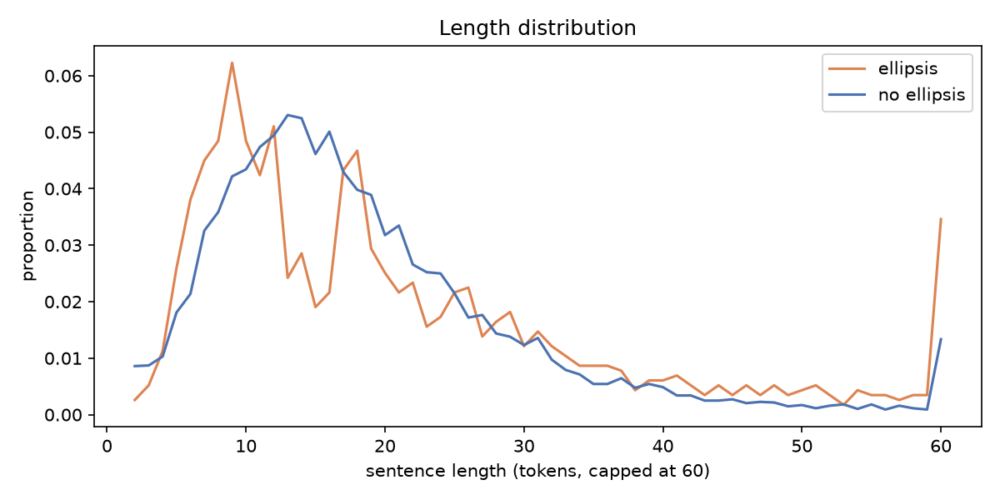
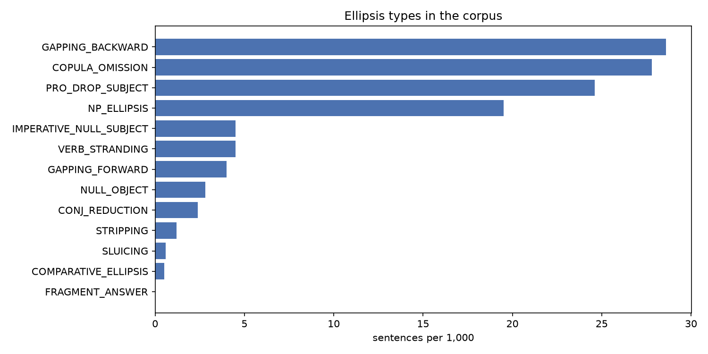
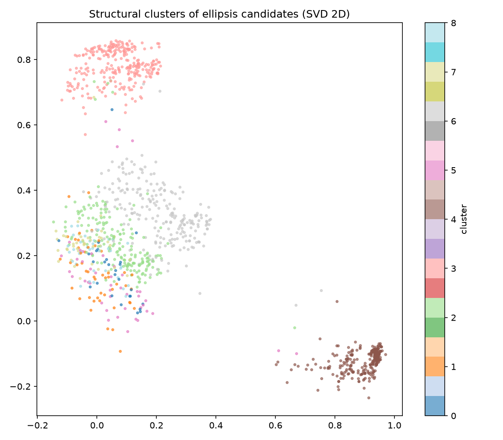
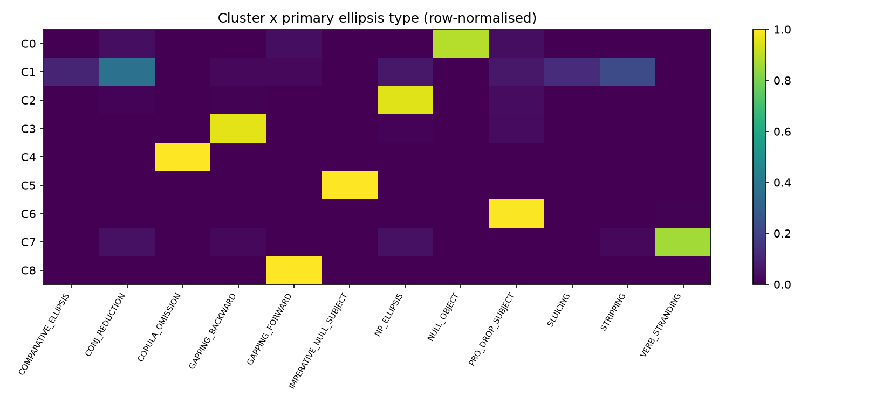
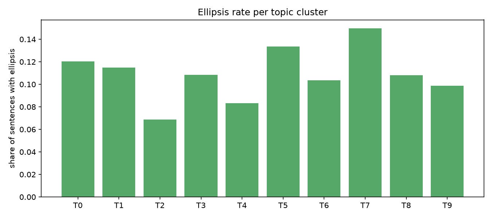

# Hindi Ellipsis Analysis Report

**Run:** source=file, path=indiccorpv2_hindi/data/hi-*.txt, max_sentences=10000, min_conf=0.0, embed=none, stanza=False

## 1. Corpus overview (Level 1: ellipsis vs. no ellipsis)

- Sentences analysed: **10,000**  (tokens: 189,477)
- Sentences with at least one ellipsis candidate: **1,156** (11.56%)
- Mean length - ellipsis: 20.7 tokens, no ellipsis: 18.56 tokens
- Families (sentences): {'DISCOURSE': 278, 'CLAUSAL': 391, 'ARGUMENT': 340, 'NOMINAL': 195}

## 2. Types of ellipsis (Level 2)

| type | family | sentences | instances | per_1000_sentences | share_of_ellipsis_sentences | mean_confidence |
|---|---|---|---|---|---|---|
| GAPPING_BACKWARD | CLAUSAL | 286 | 289 | 28.6 | 0.2474 | 0.503 |
| COPULA_OMISSION | DISCOURSE | 278 | 278 | 27.8 | 0.2405 | 0.36 |
| PRO_DROP_SUBJECT | ARGUMENT | 246 | 254 | 24.6 | 0.2128 | 0.727 |
| NP_ELLIPSIS | NOMINAL | 195 | 199 | 19.5 | 0.1687 | 0.588 |
| IMPERATIVE_NULL_SUBJECT | ARGUMENT | 45 | 50 | 4.5 | 0.0389 | 0.675 |
| VERB_STRANDING | CLAUSAL | 45 | 46 | 4.5 | 0.0389 | 0.526 |
| GAPPING_FORWARD | CLAUSAL | 40 | 41 | 4.0 | 0.0346 | 0.612 |
| NULL_OBJECT | ARGUMENT | 28 | 29 | 2.8 | 0.0242 | 0.571 |
| CONJ_REDUCTION | ARGUMENT | 24 | 24 | 2.4 | 0.0208 | 0.65 |
| STRIPPING | CLAUSAL | 12 | 12 | 1.2 | 0.0104 | 0.683 |
| SLUICING | CLAUSAL | 6 | 6 | 0.6 | 0.0052 | 0.625 |
| COMPARATIVE_ELLIPSIS | CLAUSAL | 5 | 5 | 0.5 | 0.0043 | 0.61 |
| FRAGMENT_ANSWER | DISCOURSE | 0 | 0 | 0.0 | 0.0 | 0.0 |

### Subtypes

| type | subtype | instances |
|---|---|---|
| GAPPING_BACKWARD | verb_final_conjunct | 289 |
| COPULA_OMISSION | headline_telegraphic | 267 |
| PRO_DROP_SUBJECT | 2fam_discourse | 192 |
| NP_ELLIPSIS | वाला_headless_participial | 96 |
| NP_ELLIPSIS | quantifier_stranded | 76 |
| PRO_DROP_SUBJECT | 1sg_discourse | 46 |
| VERB_STRANDING | plain | 40 |
| GAPPING_FORWARD | plain | 39 |
| NULL_OBJECT | default_agreement | 26 |
| IMPERATIVE_NULL_SUBJECT | honorific_आप | 25 |
| IMPERATIVE_NULL_SUBJECT | familiar_तुम | 25 |
| CONJ_REDUCTION | shared_subject | 24 |
| NP_ELLIPSIS | वाला_other | 21 |
| PRO_DROP_SUBJECT | 1sg_shared_antecedent | 16 |
| COPULA_OMISSION | under_negation | 11 |
| VERB_STRANDING | with_भी | 6 |
| NP_ELLIPSIS | adjective_stranded | 6 |
| STRIPPING | additive_भी | 5 |
| STRIPPING | contrastive_bare | 4 |
| COMPARATIVE_ELLIPSIS | correlative_जितना | 3 |
| SLUICING | wh_fragment_question | 3 |
| STRIPPING | negative_नहीं | 3 |
| NULL_OBJECT | feminine_agreement_with_silent_object | 3 |
| COMPARATIVE_ELLIPSIS | correlative_उतना_verbless | 2 |
| SLUICING | embedded_uncertainty | 2 |
| GAPPING_FORWARD | with_particle | 2 |
| SLUICING | matrix_with_correlate | 1 |

## 3. Why does each ellipsis occur? (licensing + corpus evidence)

### GAPPING_BACKWARD  (CLAUSAL)

As an SOV, verb-final language Hindi also allows BACKWARD gapping: the verb is pronounced only in the final conjunct and the earlier conjunct is verbless (राम ने चाय, और सीता ने कॉफ़ी पी). This direction follows from head-finality (Ross 1970's directionality generalisation).

Strongest associated cues in this corpus:

| cue | P(cue|type) | P(cue|rest) | odds_ratio | p_value |
|---|---|---|---|---|
| has_coordination | 1.0 | 0.2923 | 1387.449 | 3.625911374758423e-142 |
| long_sentence_gt20 | 0.6259 | 0.3247 | 3.473 | 3.458642641876232e-26 |
| has_ergative_ne | 0.458 | 0.2842 | 2.129 | 2.55374580541162e-10 |
| has_vala | 0.0874 | 0.0555 | 1.658 | 0.029506497954675873 |

Examples:

- उन्होंने अपने पति और कोच रोबर्ट बाबी जार्ज के साथ उन्होंने अभ्यास करना शुरू कर दिया।  
  → remnant: `उन्होंने अपने पति और` · subtype: verb_final_conjunct · conf 0.8
- जब हमने नामधारी से निर्मल बाबा के विचारों और चमत्कारों के बारे में पूछा तो उन्होंने साफ कहा कि वे इससे जरा भी इत्तेफाक़ नहीं रखते।  
  → remnant: `जब हमने नामधारी से निर्मल बाबा के विचारों और` · subtype: verb_final_conjunct · conf 0.8
- देश के कई राज्यों के छात्रों ने हाथ में तिरंगा तो मैक्सिको व नेपाल के छात्रों ने अपना राष्ट्रीय झंडा पकड़ा हुआ था।  
  → remnant: `देश के कई राज्यों के छात्रों ने हाथ में तिरंगा तो मैक्सिको व` · subtype: verb_final_conjunct · conf 0.8
- इसके तहत चुनिंदा जिलों में चना 19 क्विंटल प्रति हेक्टेयर और सरसों 15 क्विंटल तक खरीदा जाएगा।  
  → remnant: `इसके तहत चुनिंदा जिलों में चना 19 क्विंटल प्रति हेक्टेयर और` · subtype: verb_final_conjunct · conf 0.5
- गढ़वाल मंडल में हेलीकाप्टर गौचर और कुमाऊं मंडल में हेलीकाप्टर पिथौरागढ़ में तैनात किया गया है।  
  → remnant: `गढ़वाल मंडल में हेलीकाप्टर गौचर और` · subtype: verb_final_conjunct · conf 0.5

### COPULA_OMISSION  (DISCOURSE)

The present copula है/हैं can be dropped under negation (वह घर पर नहीं) and in telegraphic registers such as news headlines (मोदी आज वाराणसी में). Tense is recovered from context; this is register-driven ellipsis.

Strongest associated cues in this corpus:

| cue | P(cue|type) | P(cue|rest) | odds_ratio | p_value |
|---|---|---|---|---|
| is_verbless | 1.0 | 0.0568 | 9245.192 | 0.0 |
| has_imperative_form | 0.0324 | 0.0495 | 0.677 | 0.24543833132778667 |
| has_1sg_agreement | 0.0072 | 0.0132 | 0.675 | 0.5496988425780539 |
| has_negation | 0.0827 | 0.1202 | 0.673 | 0.07041648860895536 |

Examples:

- व्यापारिक समूह को इससे चिन्तित होने की जरूरत नहीं ।  
  → remnant: `की जरूरत नहीं ∅[है]` · subtype: under_negation · conf 0.6
- लेकिन कुकू बाला और उनके तीन बच्चों के लिए मुश्किलें कम नहीं।  
  → remnant: `मुश्किलें कम नहीं ∅[है]` · subtype: under_negation · conf 0.6
- कोई मुंह खोलने को तैयार नहीं  
  → remnant: `को तैयार नहीं ∅[है]` · subtype: under_negation · conf 0.6
- पटना में बिजली की कमी नहीं  
  → remnant: `की कमी नहीं ∅[है]` · subtype: under_negation · conf 0.6
- अब तक कोई दिशा-निदर्ेश नहीं  
  → remnant: `दिशा निदर्ेश नहीं ∅[है]` · subtype: under_negation · conf 0.6

### PRO_DROP_SUBJECT  (ARGUMENT)

Hindi is a (consistent/partial) pro-drop language: finite verbs and auxiliaries carry person-number-gender agreement (हूँ = 1sg, -ोगे = 2fam, -ूँगा = 1sg.fut), so an overt subject pronoun is redundant when the referent is a discourse topic. Overt pronouns appear mainly for contrast, focus or topic shift.

Strongest associated cues in this corpus:

| cue | P(cue|type) | P(cue|rest) | odds_ratio | p_value |
|---|---|---|---|---|
| has_1sg_agreement | 0.2439 | 0.0072 | 44.562 | 6.6069413711817465e-226 |
| has_wh | 0.0407 | 0.0261 | 1.651 | 0.23085761728439852 |
| long_sentence_gt20 | 0.4065 | 0.3315 | 1.384 | 0.016497167497988862 |
| has_coordination | 0.3618 | 0.3113 | 1.257 | 0.10542655283838266 |

Examples:

- नोएडा सेक्टर 16 में एक कंपनी में काम करता हूं।  
  → remnant: `∅[मैं] + हूं` · subtype: 1sg_discourse · conf 0.85
- हिंदी न्यूज़ उत्तर प्रदेश बदायूं मंदिरों में जलाभिषेक को कछला घाट से कांवड़ियो ने भरा जल, देखें Video  
  → remnant: `∅[मैं] + बदायूं` · subtype: 1sg_discourse · conf 0.85
- बैठक के दौरान दोनों पक्ष कृषि, विशेष रूप से चावल, गेहूं, तिलहन सहित आपसी हितों की विभिन्न जिन्सों के व्यापार में बढ़ोतरी करने, आपसी क्षमता निर्माण, मत्स्य पालन में तकनीकी सहयोग, बीज और चारे के विकास में सहयोग आदि के बारे में सहयोग बढ़ाने के प्रयास करने पर रजामंद थे।  
  → remnant: `∅[मैं] + गेहूं` · subtype: 1sg_discourse · conf 0.85
- इसके तहत चावल तीन रुपये और गेहूं दो रुपया प्रति किलो के हिसाब से मुहैया करवाएंगे जाएंगे जिसका फायदा एक करोड़ तीस लाख लोगों को मिलेगा।  
  → remnant: `∅[मैं] + गेहूं` · subtype: 1sg_discourse · conf 0.85
- भवाली मल्ली, सल्ट तहसील में भारत के उत्तराखण्ड राज्य के अन्तर्गत कुमाऊँ मण्डल के अल्मोड़ा जिले का एक गाँव है।  
  → remnant: `∅[मैं] + कुमाऊँ` · subtype: 1sg_discourse · conf 0.85

### NP_ELLIPSIS  (NOMINAL)

Nominal (N') ellipsis: the head noun is omitted and a modifier survives (लाल वाली, दोनों ने, बड़ों को). Hindi वाला acts like English 'one' (a nominal anaphor), and adjectives/quantifiers carrying gender-number-case inflection keep the head recoverable.

Strongest associated cues in this corpus:

| cue | P(cue|type) | P(cue|rest) | odds_ratio | p_value |
|---|---|---|---|---|
| has_vala | 0.6 | 0.0456 | 31.303 | 7.041897687148679e-240 |
| has_wh | 0.041 | 0.0262 | 1.681 | 0.2936065851940016 |
| is_question | 0.0154 | 0.0114 | 1.567 | 0.861345088359819 |
| has_ergative_ne | 0.3846 | 0.2873 | 1.554 | 0.003876066992377384 |

Examples:

- दैनिक भास्कर हिंदी: कांग्रेस नेताओं का बयान- गरीबों को शराब-तंबाकू के लिए पैसे दे रही कमलनाथ सरकार  
  → remnant: `गरीबों ∅[N] को` · subtype: quantifier_stranded · conf 0.6
- हमें आशा है कि आप सभी को यह Poem on Education in Hindi अवश्य पसंद आयी होंगी।  
  → remnant: `सभी ∅[N] को` · subtype: quantifier_stranded · conf 0.6
- पुलिस ने खदेड़ कर तीनों को दबोच लिया।  
  → remnant: `तीनों ∅[N] को` · subtype: quantifier_stranded · conf 0.6
- इन तीनों को रामानुजन रेखांकन (Ramanujan Graphs) और कैडिसन-सिंगर प्रॉब्लम (Kadison-Singer Problem) पर लंबे समय तक सवाल हल करने के लिए विजेताओं के रूप में नामित किया गया है।  
  → remnant: `तीनों ∅[N] को` · subtype: quantifier_stranded · conf 0.6
- इन सवालों को हल करते हुए, उन तीनों ने रैखिक बीजगणित, ग्राफ सिद्धांत और बहुपद की ज्यामिति के बीच एक नए संबंध को उजागर किया।  
  → remnant: `तीनों ∅[N] ने` · subtype: quantifier_stranded · conf 0.6

### IMPERATIVE_NULL_SUBJECT  (ARGUMENT)

Imperative morphology (-ओ familiar, -इए/-िए honorific) encodes the addressee and the politeness level, so the 2nd-person subject (तुम/आप) is recoverable from the verb and from the speech situation.

Strongest associated cues in this corpus:

| cue | P(cue|type) | P(cue|rest) | odds_ratio | p_value |
|---|---|---|---|---|
| has_imperative_form | 1.0 | 0.0447 | 1942.661 | 2.2593040070683513e-188 |
| has_coordination | 0.5111 | 0.3116 | 2.307 | 0.006533555822632311 |
| has_overt_pronoun_subj | 0.4222 | 0.2583 | 2.113 | 0.01957132755103746 |
| has_negation | 0.2 | 0.1188 | 1.929 | 0.14817338108370404 |

Examples:

- इसलिए प्रिय पाठकों आपसे निवेदन है कि अगर आपको अपने जीवन में सच्ची शिक्षा का आनंद लेना है तो अपनी मायावी दुनिया से बाहर निकलकर थोड़ा सामाजिक बनिए, प्रकृति के समक्ष जाइए, जिससे संभव ही आप जीवन में सच्ची शिक्षा के ज्ञान का आनंद उठा पाएंगे।  
  → remnant: `∅[आप] + जाइए` · subtype: honorific_आप · conf 0.75
- आप अपने सुझाव व विचार भी हमसे साझा कर सकते है, नीचे उपस्थित कमेंट बॉक्स के जरिये।  
  → remnant: `∅[आप] + जरिये` · subtype: honorific_आप · conf 0.75
- इनकी काया पर मत जाइए।  
  → remnant: `∅[आप] + जाइए` · subtype: honorific_आप · conf 0.75
- रनवीर ने कहा कि फिल्म के ट्रेलर को लेकर उनके और आदित्य के बीच बहस भी हुई थी, लेकिन वह दर्शकों को इस फिल्म के विभिन्न पहलुओं से वाकिफ कराना चाहते थे. इसलिए, उन्होंने थोड़े कट के साथ प्रोमो को जारी किया.  
  → remnant: `∅[आप] + इसलिए` · subtype: honorific_आप · conf 0.75
- इस दौरान उन्होंने कहा कि आप लोग भ्रमित और गुमराह करने की राजनीति को समझिए और पहचानिए, क्योंकि शिवराज जब तक झूठ नहीं बोलते, तब तक उनके पेट का अन्न नहीं पचता।  
  → remnant: `∅[आप] + समझिए` · subtype: honorific_आप · conf 0.75

### VERB_STRANDING  (CLAUSAL)

Repeated verb with missing internal argument after भी: either verb-stranding VP ellipsis (the verb moves out of the VP before the VP is elided) or argument ellipsis of the object. Hindi-Urdu is a key language in this debate because verb movement and complex predicates interact with ellipsis.

Strongest associated cues in this corpus:

| cue | P(cue|type) | P(cue|rest) | odds_ratio | p_value |
|---|---|---|---|---|
| has_coordination | 1.0 | 0.3094 | 203.107 | 1.0079469275288901e-22 |
| long_sentence_gt20 | 0.8 | 0.3312 | 7.758 | 8.142591115380747e-11 |
| has_1sg_agreement | 0.0444 | 0.0129 | 4.395 | 0.2274785085644333 |
| has_negation | 0.2889 | 0.1184 | 3.091 | 0.001000383866391233 |

Examples:

- मैं योग सिखाकर अपना खर्च चलाती हूं और फिजियोथेरेपी के लिये भी लोगों की मदद करती हूं ।  
  → remnant: `और फिजियोथेरेपी के लिये भी लोगों की मदद करती हूं` · subtype: with_भी · conf 0.7
- उसके मस्तिष्क में नेतृत्व करने की एवं सत्ता स्थापित करने की इच्छा भी जरूर उत्पन्न होंगी।  
  → remnant: `एवं सत्ता स्थापित करने की इच्छा भी जरूर उत्पन्न होंगी` · subtype: with_भी · conf 0.7
- मीडिया प्रभारी विकास दाबड़ा ने बताया कि विशेष रूप से बाबा का भव्य शृंगार किया जायेगा तथा छप्पन भोग भी लगाया जायेगा।  
  → remnant: `तथा छप्पन भोग भी लगाया जायेगा` · subtype: with_भी · conf 0.7
- सोशल मीडिया में भांगड़ा करते हुए छोटे से बच्चे का वीडियो वायरल हो रहा है. वीडियो में एक पंजाबी बच्चा घर के गेट के सामने भांगड़ा कर रहा है. दूसरी तरफ दो डॉगी उसे देखकर उछल कूद मचा रहे हैं और भौंक भी रहे हैं. इसे लोग खूब पसंद कर रहे हैं. इस वीडियो को आईपीएस अफसर दिपांशू काबरा ने ट्विटर पर शेयर किया है.  
  → remnant: `और भौंक भी रहे हैं` · subtype: with_भी · conf 0.7
- विश्वसनीय वीपीएन प्रदाता अन्य स्थानों से एचडी सामग्री स्ट्रीमिंग के लिए तेज़ नेटवर्क प्रदान करेंगे और साथ ही आपकी गोपनीयता की रक्षा भी करेंगे. - सबसे पहले एक बड़े बर्तन में तेल लें।  
  → remnant: `और साथ ही आपकी गोपनीयता की रक्षा भी करेंगे` · subtype: with_भी · conf 0.7

### GAPPING_FORWARD  (CLAUSAL)

Gapping deletes the finite verb (and often the auxiliary) of a non-initial conjunct, leaving two or more contrastive remnants. Hindi remnants keep their case markers (ने/को/से), which makes the parallel argument structure recoverable from morphology alone.

Strongest associated cues in this corpus:

| cue | P(cue|type) | P(cue|rest) | odds_ratio | p_value |
|---|---|---|---|---|
| has_coordination | 1.0 | 0.3097 | 180.494 | 2.738162771094527e-20 |
| long_sentence_gt20 | 0.7 | 0.3318 | 4.591 | 1.9192751889175986e-06 |
| is_question | 0.025 | 0.0114 | 3.266 | 0.9526033688136323 |
| has_negation | 0.3 | 0.1185 | 3.262 | 0.0009961756004515246 |

Examples:

- आज की बात: क्या राज्यसभा में मार्शल ने सांसदों को पीटा या सांसदों ने महिला मार्शल के साथ हाथापाई की?  
  → remnant: `या सांसदों ने महिला मार्शल के साथ हाथापाई की` · subtype: plain · conf 0.85
- - 30 जुलाई को भारत ने अमेरिका से कहा कि न्यूयॉर्क पुलिस की कस्टडी में मौजूद नौकरानी को भारतीय दफ्तर में लाया जाए लेकिन भारत की मांग पर अमेरिका ने कोई कार्रवाई नहीं की।  
  → remnant: `लेकिन भारत की मांग पर अमेरिका ने कोई कार्रवाई नहीं की` · subtype: plain · conf 0.85
- थल सेना ने लिखा है कि भारतीय सैन्य टुकड़ी ने सफलतापूर्वक वाई नाला से पीएलए की चौकी को खाली करा दिया तथा वे पीपी 14 पहुंचे, जहां भारतीय थल सेना और पीएलए के सैनिकों के बीच झड़प हुई. कर्नल बी संतोष बाबू ने नेतृत्व संभाला और उनके सैनिक बहादुरी से लड़े, जिसमें पीएलए के कई सैनिक हताहत हुए. इस लड़ाई में 20 'गलवान के वीर' शहीद हो गये.  
  → remnant: `और उनके सैनिक बहादुरी से लड़े` · subtype: plain · conf 0.6
- थल सेना ने लिखा है कि भारतीय सैन्य टुकड़ी ने सफलतापूर्वक वाई नाला से पीएलए की चौकी को खाली करा दिया तथा वे पीपी 14 पहुंचे, जहां भारतीय थल सेना और पीएलए के सैनिकों के बीच झड़प हुई. कर्नल बी संतोष बाबू ने नेतृत्व संभाला और उनके सैनिक बहादुरी से लड़े, जिसमें पीएलए के कई सैनिक हताहत हुए. इस लड़ाई में 20 'गलवान के वीर' शहीद हो गये.  
  → remnant: `तथा वे पीपी 14 पहुंचे` · subtype: plain · conf 0.6
- UP Police Admit Card 2019: उत्तर प्रदेश पुलिस भर्ती एवं प्रोन्नति बोर्ड द्वारा सब इंस्पेक्टर (SI), असिस्टेंट सब इंस्पेक्टर (ASI) और कंप्यूटर ऑपरेटर पदों के लिए आयोजित परीक्षा के एडमिट कार्ड जारी कर दिए हैं।  
  → remnant: `एवं प्रोन्नति बोर्ड द्वारा सब इंस्पेक्टर ( SI )` · subtype: plain · conf 0.6

### NULL_OBJECT  (ARGUMENT)

Hindi allows argument (object) ellipsis when the object is given in discourse. In perfective transitive clauses the subject takes ergative ने and the verb agrees with the (unmarked) object; when that object is elided the verb either shows default -ा agreement or keeps agreeing with the silent object (e.g. feminine -ी), which is evidence that the null object is syntactically present (argument ellipsis, not just an intransitive use).

Strongest associated cues in this corpus:

| cue | P(cue|type) | P(cue|rest) | odds_ratio | p_value |
|---|---|---|---|---|
| has_ergative_ne | 1.0 | 0.2872 | 141.45 | 5.557395566903704e-16 |
| has_1sg_agreement | 0.0357 | 0.0129 | 4.146 | 0.8202559515096779 |
| has_coordination | 0.4643 | 0.3121 | 1.92 | 0.1257479916013031 |
| is_question | 0.0 | 0.0115 | 1.497 | 1.0 |

Examples:

- हालांकि घटना की जानकारी सुबह ग्रामीणों ने दी।  
  → remnant: `हालांकि घटना की जानकारी सुबह ग्रामीणों ने ∅[OBJ] दी` · subtype: feminine_agreement_with_silent_object · conf 0.75
- यह जानकारी विभाग के अध्यक्ष डा. पवन पोद्दार ने दी।  
  → remnant: `पवन पोद्दार ने ∅[OBJ] दी` · subtype: feminine_agreement_with_silent_object · conf 0.75
- यह जानकारी शनिवार देर शाम यूपी के उपमुख्यमंत्री डॉ. दिनेश शर्मा ने दी ।  
  → remnant: `दिनेश शर्मा ने ∅[OBJ] दी` · subtype: feminine_agreement_with_silent_object · conf 0.75
- महोत्सव का आयोजन श्री श्याम सत्संग मंडल एवं श्री श्याम युवा मित्र मंडल ने किया है।  
  → remnant: `श्री श्याम युवा मित्र मंडल ने ∅[OBJ] किया है` · subtype: default_agreement · conf 0.55
- शिविर का संचालन संजीत कुमार ताँतिया ने किया और शिविर में जुगनु राय, रमेश रजक, प्रह्लाद रजक, काजू शर्मा, रीता शर्मा, नीना शर्मा, सन्जू देवी, श्याम सिंह, ब्यूटी सिंह, गणेश पासवान, शंकर कापडी, मनोज राऊथ, दिनेश वर्मा, मनोज पासवान आदि अनेको प्रशिक्षुओं ने भाग लेकर महान नेता श्यामाप्रसाद मुखर्जी एव्ं दीनदयाल जी के जीवन के बारे में विस्तार पुर्वक जाना।  
  → remnant: `शिविर का संचालन संजीत कुमार ताँतिया ने ∅[OBJ] किया` · subtype: default_agreement · conf 0.55

### CONJ_REDUCTION  (ARGUMENT)

In clausal coordination, an argument shared with the first conjunct (usually the subject/topic) is omitted in the second conjunct. This is licensed by topic continuity and by the parallelism of coordinated clauses (conjunction reduction / across-the-board subject sharing).

Strongest associated cues in this corpus:

| cue | P(cue|type) | P(cue|rest) | odds_ratio | p_value |
|---|---|---|---|---|
| has_coordination | 1.0 | 0.3108 | 108.625 | 1.7304970380093864e-12 |
| has_overt_pronoun_subj | 0.625 | 0.2581 | 4.689 | 0.00011130095666454601 |
| has_indefinite | 0.25 | 0.0799 | 4.044 | 0.007212856506413627 |
| has_negation | 0.2917 | 0.1188 | 3.178 | 0.021714168428427827 |

Examples:

- वहीं ट्रेंड के चक्कर में पड़ने की जगह ऐसे क्लोद्स को चुनें, जो आप पर सूट करें और आते-जाते फैशन ट्रेंड्स उस पर असर न डालें।  
  → remnant: `और ∅[SUBJ] आते` · subtype: shared_subject · conf 0.65
- हमने आलाकमान से एक ही बात कही थी कि हम सचिन पायलट के साथ हैं और रहेंगे।  
  → remnant: `और ∅[SUBJ] रहेंगे` · subtype: shared_subject · conf 0.65
- नतीजतन कुछ सालों तक उत्पादन में कमी के बाद लघु अवधि में देश में अतिरिक्त उत्पादन की स्थिति बनी जिससे फसलों की कीमतें कम हुईं और इससे ग्रामीण आमदनी पर असर पड़ा।  
  → remnant: `और ∅[SUBJ] इससे ग्रामीण आमदनी पर असर पड़ा` · subtype: shared_subject · conf 0.65
- फायदे: मानसिक शक्ति बढ़ती है और ध्यान में सहायता मिलती है।  
  → remnant: `और ∅[SUBJ] ध्यान में सहायता मिलती है` · subtype: shared_subject · conf 0.65
- भगौड़ा आर्थिक अपराधी से एक ऐसा व्‍यक्‍ति अभिप्रेत है, जिसके विरूद्ध किसी सूचीबद्ध अपराध के संबंध में गिरफ्तारी का वारंट जारी किया जा चुका है और जिसने आपराधिक कार्यवाही से बचने के लिए भारत छोड़ दिया है अथवा विदेश में रह रहा है और आपराधिक अभियोजन का समाना करने के लिए भारत लौटने से इंकार कर रहा है।  
  → remnant: `अथवा ∅[SUBJ] विदेश में रह रहा है` · subtype: shared_subject · conf 0.65

### STRIPPING  (CLAUSAL)

Stripping / bare-argument ellipsis: the whole clause except one remnant is elided. In Hindi the remnant is typically hosted by a focus particle (भी 'also', ही 'only') or negation (नहीं), which marks the remnant as contrastive/additive focus and licenses the deletion of the given (background) material.

Strongest associated cues in this corpus:

| cue | P(cue|type) | P(cue|rest) | odds_ratio | p_value |
|---|---|---|---|---|
| has_coordination | 1.0 | 0.3117 | 55.207 | 1.3681303750733004e-06 |
| has_negation | 0.75 | 0.1184 | 20.195 | 2.9356038092659367e-10 |
| is_question | 0.0833 | 0.0114 | 11.249 | 0.3267348577361451 |
| has_focus_particle | 0.6667 | 0.2433 | 5.874 | 0.0020888881149173054 |

Examples:

- 1 गिलास पानी में होते हैं 1 करोड़ बैक्टीरिया, लेकिन चिंता की बात नहीं  
  → remnant: `लेकिन चिंता की बात नहीं` · subtype: negative_नहीं · conf 0.8
- तालिबान के नेताओं ने कहा, 'महिलाओं के साथ कोई भेदभाव नहीं किया जाएगा, लेकिन उन्हें जो भी अधिकार दिए जाएंगे, वो इस्लाम के मुताबिक होंगे. महिलाओं को स्वास्थ्य और दूसरे क्षेत्रों में काम करने की इजाजत दी जाएगी, जहां उनकी जरूरत है. अब सवाल ये है कि तालिबान ये फैसला किस आधार पर करेगा. ये कैसे तय होगा कि महिलाओं की मीडिया में तो जरूरत है, लेकिन दूसरे क्षेत्रों में नहीं?  
  → remnant: `लेकिन दूसरे क्षेत्रों में नहीं` · subtype: negative_नहीं · conf 0.8
- यही बात इन 39 लोगों के बारे में भी कही जा सकती है और केरल की उन लड़कियों के बारे में भी, जो नर्स की नौकरी करने के लिए युद्धग्रस्त क्षेत्र जाने को तैयार हो गई थीं।  
  → remnant: `और केरल की उन लड़कियों के बारे में भी` · subtype: additive_भी · conf 0.8
- ग्रिड कनेक्टेड सोलर सिस्टम लगाने वाले उपभोक्ताओं को प्रोज्यूमर्स कहा जाता है, वे बिजली की खपत भी करते हैं और सौर ऊर्जा के जरिए बिजली का उत्पादन भी।  
  → remnant: `और सौर ऊर्जा के जरिए बिजली का उत्पादन भी` · subtype: additive_भी · conf 0.8
- कई समय बीत चुके हैं और अभी भी, भारत में सबसे ज्यादा खेला जाने वाला खेल दिन की रोशनी में नहीं देखा गया है।  
  → remnant: `और अभी भी` · subtype: additive_भी · conf 0.8

### SLUICING  (CLAUSAL)

Sluicing: a clause is elided leaving only a wh-phrase. Hindi is wh-in-situ, so sluicing is analysed either as wh-movement + TP deletion or as a reduced (pseudo-)cleft/copular clause. It is typically licensed by an uncertainty predicate (पता नहीं, मालूम नहीं) and an indefinite correlate (किसी, कोई, कुछ) in the antecedent.

Strongest associated cues in this corpus:

| cue | P(cue|type) | P(cue|rest) | odds_ratio | p_value |
|---|---|---|---|---|
| has_wh | 1.0 | 0.0259 | 487.713 | 5.292845276864557e-42 |
| is_question | 0.8333 | 0.011 | 327.992 | 1.335703853702889e-64 |
| has_negation | 0.6667 | 0.1189 | 13.338 | 0.0004485861393664632 |
| is_verbless | 0.3333 | 0.0828 | 6.147 | 0.1380221947126591 |

Examples:

- अब सवाल है कि एनपीआर है क्या?  
  → remnant: `एनपीआर है क्या` · subtype: embedded_uncertainty · conf 0.8
- सवाल : टूर के नाम पर छात्रों से पांच-पांच हजार रुपये लिए गए, लेकिन टूर नहीं ले जाया जा रहा, क्यों?  
  → remnant: `क्यों` · subtype: embedded_uncertainty · conf 0.8
- - कैल्शियम कार्बाइड ही क्या, कोई भी केमिकल बॉडी के लिए एक्सेप्टेबल नहीं होता है।  
  → remnant: `कार्बाइड ही क्या` · subtype: matrix_with_correlate · conf 0.65
- क्या नहीं?  
  → remnant: `क्या नहीं` · subtype: wh_fragment_question · conf 0.5
- जावेद अख्तर के कितने बेटे-बेटी और उनके कितने?  
  → remnant: `उनके कितने` · subtype: wh_fragment_question · conf 0.5

### COMPARATIVE_ELLIPSIS  (CLAUSAL)

Comparative clauses (जितना ... उतना, X से ज़्यादा) elide the predicate that is identical to the matrix clause; the correlative structure of Hindi comparatives provides the parallelism needed for recovery.

Strongest associated cues in this corpus:

| cue | P(cue|type) | P(cue|rest) | odds_ratio | p_value |
|---|---|---|---|---|
| has_focus_particle | 0.8 | 0.2435 | 9.318 | 0.017484015532938924 |
| is_question | 0.0 | 0.0115 | 7.777 | 1.0 |
| has_1sg_agreement | 0.0 | 0.013 | 6.873 | 1.0 |
| has_indefinite | 0.2 | 0.0802 | 3.819 | 0.8711989017721185 |

Examples:

- गौरतलब है कि केंद्र सरकार ने जनता को राहत देने के लिए पेट्रोल डीजल के दामों 2.50 रुपये की कमी की थी. इतनी ही कमी बीजेपी शासित राज्यों की सरकारों ने भी की थी लेकिन तेल की कीमतों में हो रही निरंतर वृद्धि से लग रहा है कि जनता को जितनी राहत दी गई है जल्द ही उतनी कीमतें बढ़ जाएंगी.  
  → remnant: `उतनी कीमतें बढ़ जाएंगी` · subtype: correlative_उतना_verbless · conf 0.7
- बंदूक से निकली गोली किसी की भी जान ले सकती है. यह हथियार जितना खतरनाक है उतना ही...  
  → remnant: `उतना ही` · subtype: correlative_उतना_verbless · conf 0.7
- खेती की भाषा में जितने बड़े क्षेत्र में फसल की बोआई या रोपाई होती है, उसे रकबा कहा जाता है।  
  → remnant: `खेती की भाषा में जितने बड़े क्षेत्र में फसल की बोआई` · subtype: correlative_जितना · conf 0.55
- 9. प्रभु श्रीराम जितने वीर, धैर्यवान, आज्ञाकारी थे, उतने ही करुणामय थे।  
  → remnant: `प्रभु श्रीराम जितने वीर` · subtype: correlative_जितना · conf 0.55
- चंद्रमा सुर्य की सीध (समसूत्र पात) से जितना ही अधिक हट जायगा, उसका उतना ही अधिक भाग प्रकाशित होता जायगा ।  
  → remnant: `चंद्रमा सुर्य की सीध समसूत्र पात से जितना ही अधिक हट जायगा` · subtype: correlative_जितना · conf 0.55

## 4. Structural clusters of ellipsis sentences (Level 3a)

Silhouette scores by k: {4: 0.3518, 5: 0.3888, 6: 0.4006, 7: 0.4129, 8: 0.3823, 9: 0.4267, 10: 0.3317, 11: 0.3856, 12: 0.2643, 13: 0.2313, 14: 0.2868}

| cluster | size | share | dominant_type | type_purity | type_mix | mean_len | top_shape_ngrams |
|---|---|---|---|---|---|---|---|
| 0 | 27 | 0.0234 | NULL_OBJECT | 1.0 | NULL_OBJECT:27; GAPPING_FORWARD:1; GAPPING_BACKWARD:1; CONJ_REDUCTION:1 | 23.4 | W / W CASE_ERG AUX / CASE_ERG AUX / W W / W CASE_ERG / CASE_ERG |
| 1 | 48 | 0.0415 | CONJ_REDUCTION | 0.375 | CONJ_REDUCTION:18; STRIPPING:11; SLUICING:6; COMPARATIVE_ELLIPSIS:5 | 23.9 | W / AUX / W W / WH / PUNCT / V |
| 2 | 184 | 0.1592 | NP_ELLIPSIS | 1.0 | NP_ELLIPSIS:184; PRO_DROP_SUBJECT:6; GAPPING_BACKWARD:5; CONJ_REDUCTION:2 | 22.3 | W / W W / AUX / VALA / W VALA / PUNCT |
| 3 | 271 | 0.2344 | GAPPING_BACKWARD | 1.0 | GAPPING_BACKWARD:271; PRO_DROP_SUBJECT:8; NP_ELLIPSIS:3 | 29.2 | W / W W / W CASE / CASE / W CASE W / AUX |
| 4 | 273 | 0.2362 | COPULA_OMISSION | 1.0 | COPULA_OMISSION:273; PRO_DROP_SUBJECT:1 | 8.3 | W / W W / W CASE / W CASE W / CASE / CASE W |
| 5 | 45 | 0.0389 | IMPERATIVE_NULL_SUBJECT | 1.0 | IMPERATIVE_NULL_SUBJECT:45; GAPPING_BACKWARD:4; COPULA_OMISSION:2; CONJ_REDUCTION:1 | 19.6 | W / W W / V PUNCT / PUNCT / V / PUNCT W |
| 6 | 227 | 0.1964 | PRO_DROP_SUBJECT | 1.0 | PRO_DROP_SUBJECT:227; NP_ELLIPSIS:3; COPULA_OMISSION:2; GAPPING_BACKWARD:2 | 21.3 | W / W W / AUX / W W W / PUNCT / W AUX |
| 7 | 43 | 0.0372 | VERB_STRANDING | 1.0 | VERB_STRANDING:43; NP_ELLIPSIS:2; CONJ_REDUCTION:2; GAPPING_BACKWARD:1 | 34.0 | W / AUX / AUX AUX / W W / AUX CONJ / AUX CONJ W |
| 8 | 38 | 0.0329 | GAPPING_FORWARD | 1.0 | GAPPING_FORWARD:38 | 29.5 | W / W W / W PUNCT / W W W / CONJ / AUX |

**Cluster 0** (NULL_OBJECT, purity 1.0): pattern `W | W CASE_ERG AUX | CASE_ERG AUX | W W | W CASE_ERG | CASE_ERG`
  - संयोजन बदायूं क्लब के सचिव डा. अक्षत अशेष ने किया और संचालन रवींद्र मोहन सक्सेना ने किया।
  - हालांकि घटना की जानकारी सुबह ग्रामीणों ने दी।
  - यह जानकारी विभाग के अध्यक्ष डा. पवन पोद्दार ने दी।
**Cluster 1** (CONJ_REDUCTION, purity 0.375): pattern `W | AUX | W W | WH | PUNCT | V`
  - पलंग पर आकर बैठ जाऊं तो तुम क्या करोगी?
  - आज की बात: क्या राज्यसभा में मार्शल ने सांसदों को पीटा या सांसदों ने महिला मार्शल के साथ हाथापाई की?
  - अब सवाल है कि एनपीआर है क्या?
**Cluster 2** (NP_ELLIPSIS, purity 1.0): pattern `W | W W | AUX | VALA | W VALA | PUNCT`
  - फेक न्यूज प्रसारित करने वालों पर होगी कार्रवाई.. एसडीओ
  - जांच में सामने आया है कि युवक को लूटने वाले ‘मनोरोगी’ का 2017 से उपचार मनोरोग विशेषज्ञ के पास चल रहा है।
  - आज हम आपको जानकारी देने वाले है जिससे आपका फोन कभी चोरी नहीं होगा और आपकी कोई निजी जानकारी लीक नहीं होगी।
**Cluster 3** (GAPPING_BACKWARD, purity 1.0): pattern `W | W W | W CASE | CASE | W CASE W | AUX`
  - उन्होंने अपने पति और कोच रोबर्ट बाबी जार्ज के साथ उन्होंने अभ्यास करना शुरू कर दिया।
  - जब हमने नामधारी से निर्मल बाबा के विचारों और चमत्कारों के बारे में पूछा तो उन्होंने साफ कहा कि वे इससे जरा भी इत्तेफाक़ नहीं रखते।
  - देश के कई राज्यों के छात्रों ने हाथ में तिरंगा तो मैक्सिको व नेपाल के छात्रों ने अपना राष्ट्रीय झंडा पकड़ा हुआ था।
**Cluster 4** (COPULA_OMISSION, purity 1.0): pattern `W | W W | W CASE | W CASE W | CASE | CASE W`
  - डा. अवध दुबे, डा संजय रस्तोगी सहित कई अन्य प्रमुख चिकित्सक।
  - कोई मुंह खोलने को तैयार नहीं
  - पटना में बिजली की कमी नहीं
**Cluster 5** (IMPERATIVE_NULL_SUBJECT, purity 1.0): pattern `W | W W | V PUNCT | PUNCT | V | PUNCT W`
  - इसलिए प्रिय पाठकों आपसे निवेदन है कि अगर आपको अपने जीवन में सच्ची शिक्षा का आनंद लेना है तो अपनी मायावी दुनिया से बाहर निकलकर थोड़ा सामाजिक बनिए, प्रकृति के समक्ष जाइए, जिससे संभव ही आप जीवन में सच्ची शिक्षा के ज्ञान का आनंद उठा पाएंगे।
  - आप अपने सुझाव व विचार भी हमसे साझा कर सकते है, नीचे उपस्थित कमेंट बॉक्स के जरिये।
  - इनकी काया पर मत जाइए।
**Cluster 6** (PRO_DROP_SUBJECT, purity 1.0): pattern `W | W W | AUX | W W W | PUNCT | W AUX`
  - बैठक के दौरान दोनों पक्ष कृषि, विशेष रूप से चावल, गेहूं, तिलहन सहित आपसी हितों की विभिन्न जिन्सों के व्यापार में बढ़ोतरी करने, आपसी क्षमता निर्माण, मत्स्य पालन में तकनीकी सहयोग, बीज और चारे के विकास में सहयोग आदि के बारे में सहयोग बढ़ाने के प्रयास करने पर रजामंद थे।
  - हिंदी न्यूज़ उत्तर प्रदेश बदायूं मंदिरों में जलाभिषेक को कछला घाट से कांवड़ियो ने भरा जल, देखें Video
  - नोएडा सेक्टर 16 में एक कंपनी में काम करता हूं।
**Cluster 7** (VERB_STRANDING, purity 1.0): pattern `W | AUX | AUX AUX | W W | AUX CONJ | AUX CONJ W`
  - संसदीय जनतंत्र में विपक्ष का महत्वपूर्ण स्थान है. हालांकि सच्चे जनतंत्र में पक्ष और विपक्ष नहीं होना चाहिए. जनता के नुमाइंदे संसद में होने चाहिए और देश की संस्थाएं होनी चाहिए. दूसरे शब्दों में सच्चे जनतंत्र में संसद में बैठे सभी लोग पक्ष में भी हैं और विपक्ष में भी. वहां फैसला मुद्दों के आधार पर होना चाहिए, पर हमारे देश में तो विपक्ष है और विपक्ष भी संसदीय जनतंत्र का भरपूर मजाक उड़ा रहा है.
  - मीडिया प्रभारी विकास दाबड़ा ने बताया कि विशेष रूप से बाबा का भव्य शृंगार किया जायेगा तथा छप्पन भोग भी लगाया जायेगा।
  - उसके मस्तिष्क में नेतृत्व करने की एवं सत्ता स्थापित करने की इच्छा भी जरूर उत्पन्न होंगी।
**Cluster 8** (GAPPING_FORWARD, purity 1.0): pattern `W | W W | W PUNCT | W W W | CONJ | AUX`
  - - 30 जुलाई को भारत ने अमेरिका से कहा कि न्यूयॉर्क पुलिस की कस्टडी में मौजूद नौकरानी को भारतीय दफ्तर में लाया जाए लेकिन भारत की मांग पर अमेरिका ने कोई कार्रवाई नहीं की।
  - गांधी मैदान से दानापुर स्टेशन के लिए 10, AIMS के लिए 3, पटना साहिब के लिए 4, बिहारशरीफ के लिए तीन गई और वहां से 2 आईं, राजगीर के लिए 1, बिहटा IIT के लिए 14, एयरपोर्ट के लिए 2 और नवादा के लिए 3 डीजल बसें चलीं।
  - UP Police Admit Card 2019: उत्तर प्रदेश पुलिस भर्ती एवं प्रोन्नति बोर्ड द्वारा सब इंस्पेक्टर (SI), असिस्टेंट सब इंस्पेक्टर (ASI) और कंप्यूटर ऑपरेटर पदों के लिए आयोजित परीक्षा के एडमिट कार्ड जारी कर दिए हैं।

### Sub-patterns within each type

| type | subcluster | size | subtype_mix | pattern |
|---|---|---|---|---|
| COPULA_OMISSION | 0 | 71 | headline_telegraphic:70; under_negation:1 | W W / W W W / W W CASE W / W CASE W |
| COPULA_OMISSION | 1 | 46 | headline_telegraphic:36; under_negation:10 | W NEG / W W / W CASE / NEG PUNCT |
| COPULA_OMISSION | 2 | 30 | headline_telegraphic:30 | W CASE_ERG / W CASE_ERG W / CASE_ERG W / W W CASE_ERG |
| COPULA_OMISSION | 3 | 38 | headline_telegraphic:38 | W GEN W CASE / GEN W CASE / GEN W CASE W / GEN W |
| COPULA_OMISSION | 4 | 51 | headline_telegraphic:51 | PUNCT W / W PUNCT W / W PUNCT / W W |
| COPULA_OMISSION | 5 | 42 | headline_telegraphic:42 | W GEN / W GEN W / GEN W / W W |
| GAPPING_BACKWARD | 0 | 71 | verb_final_conjunct:71 | W W / W W W / W CASE / CASE W |
| GAPPING_BACKWARD | 1 | 30 | verb_final_conjunct:30 | CASE V AUX / W CASE V AUX / CASE V / W CASE V |
| GAPPING_BACKWARD | 2 | 44 | verb_final_conjunct:44 | CONJ W CASE W / CONJ W CASE / W CONJ W CASE / W W |
| GAPPING_BACKWARD | 3 | 42 | verb_final_conjunct:42 | W PUNCT / PUNCT W / W PUNCT W / W W |
| GAPPING_BACKWARD | 4 | 48 | verb_final_conjunct:48 | W W / W CASE / W CASE W / CASE W |
| GAPPING_BACKWARD | 5 | 51 | verb_final_conjunct:51 | W W / W GEN W / GEN W / W GEN |
| NP_ELLIPSIS | 0 | 17 | वाला_headless_participial:12; वाला_other:5 | W VALA GEN / W VALA GEN W / VALA GEN / VALA GEN W |
| NP_ELLIPSIS | 1 | 63 | quantifier_stranded:30; वाला_headless_participial:25; adjective_stranded:4 | W W / W AUX / W GEN / W W AUX |
| NP_ELLIPSIS | 2 | 18 | वाला_headless_participial:14; वाला_other:4 | W VALA CASE / W VALA CASE W / VALA CASE W / VALA CASE |
| NP_ELLIPSIS | 3 | 24 | quantifier_stranded:12; वाला_headless_participial:7; वाला_other:4 | W PUNCT / W PUNCT W / W W PUNCT / PUNCT W |
| NP_ELLIPSIS | 4 | 37 | वाला_headless_participial:34; वाला_other:3 | W VALA AUX / W W / VALA AUX / W VALA AUX PUNCT |
| NP_ELLIPSIS | 5 | 36 | quantifier_stranded:33; adjective_stranded:1; वाला_other:1 | W W / CASE W / QUANT CASE / W QUANT |
| PRO_DROP_SUBJECT | 0 | 24 | 1sg_discourse:11; 2fam_discourse:9; 1sg_shared_antecedent:4 | W V / V PUNCT / W V PUNCT / W W |
| PRO_DROP_SUBJECT | 1 | 48 | 2fam_discourse:36; 1sg_discourse:7; 1sg_shared_antecedent:5 | AUX AUX / W W / AUX AUX PUNCT / V AUX AUX |
| PRO_DROP_SUBJECT | 2 | 78 | 2fam_discourse:69; 1sg_discourse:9 | W W / CASE W / W CASE / W CASE W |
| PRO_DROP_SUBJECT | 3 | 54 | 2fam_discourse:38; 1sg_discourse:14; 1sg_shared_antecedent:2 | W PUNCT / W PUNCT W / PUNCT W / W W |
| PRO_DROP_SUBJECT | 4 | 42 | 2fam_discourse:35; 1sg_discourse:5; 1sg_shared_antecedent:2 | W W / FOC W / W FOC / W FOC W |

## 5. Topic 'parts' of the dataset (Level 3b)

| topic | size | ellipsis_rate | top_terms | rate_PRO_DROP_SUBJECT | rate_IMPERATIVE_NULL_SUBJECT | rate_NULL_OBJECT | rate_CONJ_REDUCTION | rate_GAPPING_FORWARD | rate_GAPPING_BACKWARD |
|---|---|---|---|---|---|---|---|---|---|
| 7 | 2423 | 0.1498 | यह पर और थे ही गए बाद एक से साथ | 0.0376 | 0.0037 | 0.0021 | 0.0029 | 0.0029 | 0.0198 |
| 5 | 778 | 0.1337 | दिया ने और कर पर गया एक से का बाद | 0.0129 | 0.0077 | 0.0039 | 0.0064 | 0.0064 | 0.0617 |
| 0 | 707 | 0.1202 | नहीं कोई भी लेकिन का तक से पर कि किसी | 0.0283 | 0.0042 | 0.0028 | 0.0028 | 0.0113 | 0.0269 |
| 1 | 1584 | 0.1149 | का से किया पर गया ने और एक था ही | 0.0202 | 0.0063 | 0.0032 | 0.0006 | 0.0032 | 0.0284 |
| 3 | 314 | 0.1083 | दिल्ली बताया नई ने कि से किया सिंह का कुमार | 0.0223 | 0.0032 | 0.0032 | 0.0 | 0.0064 | 0.0287 |
| 8 | 833 | 0.108 | कहा लिए कि ने उन्होंने से और करने का पर | 0.0324 | 0.006 | 0.0036 | 0.0012 | 0.0072 | 0.036 |
| 6 | 1023 | 0.1036 | भी इस से और पर का ने साथ लिए तो | 0.0283 | 0.0059 | 0.0049 | 0.0 | 0.0029 | 0.0293 |
| 9 | 476 | 0.0987 | पुलिस दी ने कर जानकारी पर गिरफ्तार गई से लिया | 0.0042 | 0.0021 | 0.0084 | 0.0 | 0.0021 | 0.0399 |
| 4 | 1163 | 0.0834 | हैं से और रहे कि पर भी कर सकते ही | 0.0129 | 0.0026 | 0.0 | 0.0043 | 0.0026 | 0.0232 |
| 2 | 699 | 0.0687 | रहा हो था जा का से कि गई गया पर | 0.0186 | 0.0014 | 0.0 | 0.0043 | 0.0 | 0.0157 |

## Research background and hypotheses

**Why Hindi is ellipsis-rich.** Four grammatical properties drive almost every
type detected here:

1. *Rich agreement + topic-oriented discourse* -> null subjects (pro-drop) and
   null objects (argument ellipsis). Hindi subjects are recoverable from verb
   agreement (हूँ, -ूँगा, -ोगे) and from discourse topicality; objects are
   recoverable when given in context.
2. *Split ergativity.* In perfective transitive clauses the subject is marked
   ने and the verb agrees with the unmarked object (Mahajan 1990). This makes
   null objects visible: the verb can keep feminine/plural agreement with an
   object that is not pronounced (राम ने ∅ पढ़ी), a classic argument that the
   null object is syntactically present.
3. *Head-final (SOV) order.* The verb is clause-final, so in coordination the
   verb can be shared forward (gapping) or *backward* (verb only in the last
   conjunct) - a directionality predicted for verb-final languages since
   Ross (1970).
4. *Postpositional case and focus particles.* Remnants keep their case markers
   (ने, को, से) and are hosted by focus particles (भी, ही) or negation (नहीं),
   which mark them as contrastive/additive foci; given material is deleted
   (stripping, verb-stranding constructions).
5. *Wh-in-situ.* Sluicing exists despite no overt wh-movement; whether it
   involves movement + deletion or a reduced copular/cleft source is debated
   for Indo-Aryan (Bhattacharya & Simpson 2012; Merchant 2001 for the
   general theory).

**Testable hypotheses this pipeline lets you check on the full corpus**

| # | Hypothesis | Where to look |
|---|---|---|
| H1 | Stripping is strongly associated with भी/नहीं (focus licensing). | `cue_association.csv`: STRIPPING x has_focus_particle / has_negation |
| H2 | Null objects concentrate in ergative clauses, and a measurable share keep non-default (fem./pl.) agreement -> syntactically real null objects. | NULL_OBJECT subtypes in `subtype_counts.csv` |
| H3 | Forward gapping is more frequent than backward gapping, but backward gapping is attested (SOV). | GAPPING_FORWARD vs GAPPING_BACKWARD rates |
| H4 | Copula omission is register-bound (headlines, short verbless lines). | COPULA_OMISSION x is_verbless / length, topic table |
| H5 | Sluicing requires an uncertainty predicate or indefinite correlate. | SLUICING subtypes, has_indefinite odds ratio |
| H6 | 1st/2nd-person subjects are dropped more often in dialogue-heavy / opinion text than in reportage. | PRO_DROP rate per topic cluster |
| H7 | Ellipsis sentences are on average longer (coordination) or much shorter (fragments) than non-ellipsis sentences - a bimodal profile. | `length_distribution.png` |

**Key references**

- Bhatt, R., Narasimhan, B., Palmer, M., Rambow, O., Sharma, D. M., & Xia, F. (2009). A multi-representational and multi-layered treebank for Hindi/Urdu. *Proc. Linguistic Annotation Workshop III*. (HDTB - annotates empty/NULL nodes; good gold source for evaluation.)
- Bhattacharya, T., & Simpson, A. (2012). Sluicing in Indo-Aryan: an investigation of Bangla and Hindi. In J. Merchant & A. Simpson (eds.), *Sluicing: Cross-Linguistic Perspectives*. OUP.
- Butt, M. (1995). *The Structure of Complex Predicates in Urdu*. CSLI.
- Doddapaneni, S. et al. (2023). Towards leaving no Indic language behind: building monolingual corpora, benchmark and models for Indic languages (IndicCorp v2). *ACL*.
- Kachru, Y. (2006). *Hindi*. John Benjamins (London Oriental and African Language Library).
- Kakwani, D. et al. (2020). IndicNLPSuite: monolingual corpora, evaluation benchmarks and pre-trained multilingual language models for Indian languages (IndicCorp v1). *Findings of EMNLP*.
- Mahajan, A. (1990). *The A/A-bar Distinction and Movement Theory*. PhD dissertation, MIT.
- Manetta, E. (2019). Verb-phrase ellipsis and complex predicates in Hindi-Urdu. *Natural Language & Linguistic Theory* 37.
- Merchant, J. (2001). *The Syntax of Silence: Sluicing, Islands, and the Theory of Ellipsis*. OUP.
- Merchant, J. (2004). Fragments and ellipsis. *Linguistics and Philosophy* 27.
- Neeleman, A., & Szendrői, K. (2007). Radical pro drop and the morphology of pronouns. *Linguistic Inquiry* 38.
- Qi, P., Zhang, Y., Zhang, Y., Bolton, J., & Manning, C. D. (2020). Stanza: a Python NLP toolkit for many human languages. *ACL demos*.
- Ross, J. R. (1970). Gapping and the order of constituents. In Bierwisch & Heidolph (eds.), *Progress in Linguistics*.
- Simpson, A., Choudhury, A., & Menon, M. (2013). Argument ellipsis and the licensing of covert nominals in Bangla, Hindi and Malayalam. *Lingua* 134.

## Caveats
- Detectors are heuristic (precision-oriented). Validate with `annotation_sample.csv` + `evaluate.py` before drawing linguistic conclusions.
- 3rd-person pro-drop cannot be detected reliably without a parser (agreement is ambiguous); use `--use_stanza`.
- Sentence-level analysis ignores cross-sentence antecedents; `prev_sentence` is stored in the outputs for manual inspection.
